# VitAdhoc

### Game Boy Advance, Game Boy and Game Boy Color, reborn for the PS Vita.

Remember trading Pokémon with a friend over a link cable? Or that one cartridge
you played until the battery died? VitAdhoc brings all of it to the Vita, and
makes it better than you remember. Your whole library on a home screen that
fills itself with box art. A picture that is pin-sharp or beautifully smooth,
and wide enough to fill the Vita's screen. Full speed, rewind, and a Continue
button that drops you back into the exact moment you left. Link play with a
friend, achievements, tilt games and ROM hacks.

All of it native to the Vita: no PSP mode, no emulator inside an emulator.

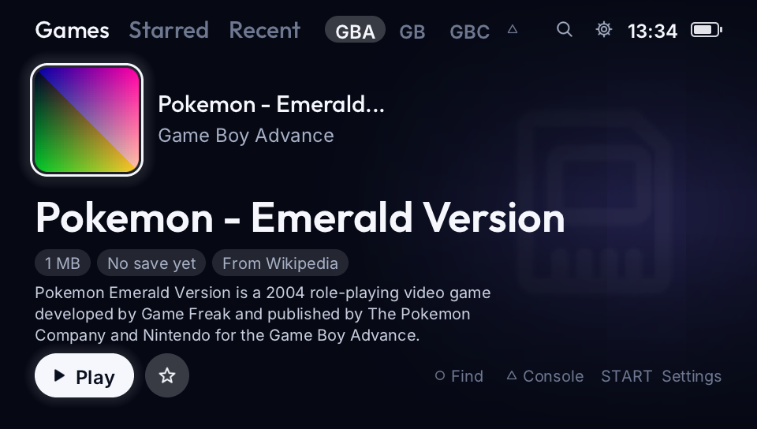

**[Download VitAdhoc 1.0](https://github.com/CBOC-Vita-Lab/vitadhoc/releases/latest/download/VitAdhoc.vpk)**
· [Install guide](INSTALL.md) · [Controls](CONTROLS.md) · [What's in 1.0](CHANGELOG.md)

You'll need your own games. No BIOS download is needed: an open one is built in.

## Highlights

- **A home screen like a real console's.** Big tiles, box art and title
  screens that download by themselves, a few lines about every game, and the
  last ten seconds you played moving behind it.
- **Continue where you left off.** Leave a game, even by closing it from
  LiveArea, and one press puts you back in that exact moment.
- **Gorgeous on the Vita's screen.** Pixel-perfect sharp, or xBRZ smoothing
  that redraws the art with clean curves, at a steady 60 frames a second.
- **Wide view.** Black bars become more of the game: in Pokémon Emerald and its
  siblings, the world really continues to the screen's edges.
- **Play together.** Trade and battle with a friend over Wi-Fi, the internet
  or ad hoc, or share one Vita side by side.
- **RetroAchievements**, with Hardcore mode for the purists.
- **Tilt, turn and sunlight games** like WarioWare: Twisted! and Boktai, using
  the Vita's own motion sensor.
- **ROM hacks and translations** with a single patch file next to the game.

## Why VitAdhoc?

[GBAdhoc](https://github.com/ShoshinFauteux/GBAdhoc) is a great PSP emulator
whose big idea is link play: trade and battle in Pokémon over Wi-Fi, just like
with a link cable. On a Vita, though, a PSP app runs inside the Vita's PSP
mode: a 480×272 picture blown up to fit, the power of a PSP, and no touch
screen or motion sensor.

VitAdhoc keeps GBAdhoc's heart (its emulator, its link play and its save
formats) and rebuilds everything around it as a real Vita app:

| | A PSP app on a Vita (PSP mode) | VitAdhoc |
| --- | --- | --- |
| **Screen** | The PSP's 480×272, scaled up | The Vita's own 960×544: crisp text, art and pixels |
| **Power** | One PSP processor | All of the Vita's cores: smoothing and drawing run beside the game |
| **Touch** | Not available | Tap, drag and flick through the home screen and menus |
| **Motion sensor** | Not available | Tilt and turn the Vita in motion games |

And then it goes much further: everything below. Already a GBAdhoc player?
Your folder, games, saves and states carry straight over.

## Performance

Measured on a real PS Vita.

| | |
| --- | --- |
| **Frame rate** | A steady 60 frames a second (the display's 59.94). Pokémon Ruby held 59.9 with xBRZ smoothing and the wide view both on. |
| **Headroom** | With xBRZ and the wide view on, a frame needs about 5 to 9 ms of its 16.7 ms: room to spare. |
| **Smoothing** | xBRZ and Scale3x run on the Vita's spare cores and the game's picture is drawn on a second core, so the game itself never waits. |
| **Input lag** | Each frame starts once the last one is on screen: up to a whole frame (17 ms) less between a press and the picture. |
| **Sound** | If the Vita falls behind for a moment, the game catches up without a gap in the sound. |
| **Saves** | Game Boy saves reach the memory card within two seconds; five state slots per game, plus 60 seconds of rewind. |
| **Overclock** | Optional 500 MHz profile for PSVshell: about a tenth less time per frame. |

[Known Issues](KNOWN-ISSUES.md) lists what is still being confirmed on a Vita.

## Everything It Does

### A library that feels like a console's own
- **Home screen.** Your games as big tiles, with the game's own picture behind
  them. Tap, drag and flick, or use the buttons.
- **Box art by itself.** On Wi-Fi, covers and title screens download on their
  own, found by name, cartridge code or checksum, so renamed files still match.
  Your own pictures always win.
- **A few lines about every game.** About 1,300 GBA, GB and GBC games come with
  the opening of their Wikipedia article, built in, no network needed.
- **Previews of your own play.** Rest on a game and the last ten seconds you
  played start moving behind it, like a streaming service's trailer.
- **Continue, Recent and play time.** One press back into the exact moment you
  left, a Recent tab, and sorting by name, last played or most played.
- **Starred and Find.** Star favourites; Find matches words in any order and
  ignores accents and punctuation.
- **Uses the games you already have.** `ux0:ROMS/` and RetroFlow's folders are
  found without moving anything.

### A picture made for the Vita's screen
- **Original:** crisp, even pixels at any size, including the full height.
- **Smooth:** xBRZ and Scale3x redraw the pixel art with clean curves. They run
  on the Vita's spare cores and only redraw what changed, so the game never
  waits for them.
- **Wide view:** instead of black bars, more of the game. Made for Pokémon
  Emerald and its siblings (Ruby, Sapphire, FireRed, LeafGreen): the map really
  continues to the screen's edges, and battles span the full width. Options
  widen 3D racing tracks too.
- **Real handheld colours** (the muted look the art was drawn for), motion
  blend for games that flicker, LCD grid and scanline looks, five screen sizes,
  and **Super Game Boy borders**.
- **A look for every game**, kept apart from the rest of your library.

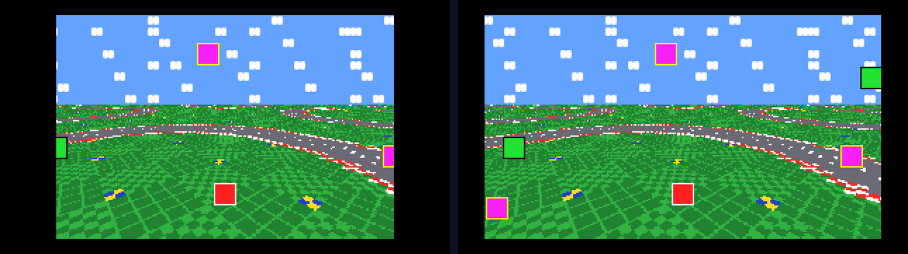

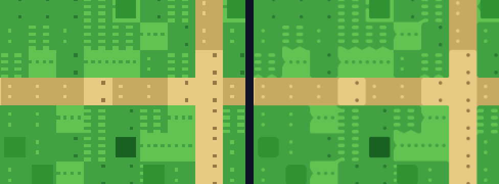

### Smooth, fast and responsive
- **The full 60 frames a second**, with the GBA's picture drawn on a second core
  while the game runs on the first.
- **Keep full speed:** if the Vita falls behind for a moment, the game catches
  up without a gap in the sound.
- **Low lag:** each frame starts once the last one is on screen, up to a frame
  less between a press and the picture.
- **Rewind** the last 60 seconds, **fast forward**, five **save-state slots**
  with pictures, **turbo buttons** and **screenshots**.
- An optional **500 MHz** profile for the PSVshell plugin.

### Play together
- **Link Cable and Wireless Adapter games** between two Vitas: trade and battle
  in Pokémon as the games intended.
- **Three ways to connect:** the same Wi-Fi, over the internet (the port opens itself
  on routers with UPnP), or ad hoc with no router at all.
- **Game Boy and Game Boy Color links**, even between two different cartridges
  (Red with Blue): each Vita lends the other its cartridge for the session.
- **Two players on one Vita**, side by side, with a second controller on a PS TV.
- **Share saves and states** between two Vitas, and receive real **Mystery
  Gift** cards from a phone.

### More to play
- **RetroAchievements**, with Hardcore mode.
- **Tilt, turn and sunlight cartridges:** WarioWare: Twisted!, Yoshi
  Topsy-Turvy, Koro Koro Puzzle, Kirby Tilt 'n' Tumble and Boktai 1–3.
- **ROM hacks and translations:** IPS, BPS and UPS patches, applied as the game
  starts; your original file is never changed.
- **Cheats** for about 2,190 games built in, plus your own GameShark, Action
  Replay, CodeBreaker and Game Genie codes.
- **No BIOS hunt:** an open GBA BIOS is built in (your own dump works too).

### A sharper emulator
VitAdhoc runs gpSP, GBAdhoc's emulator, with the latest upstream fixes, and
adds its own, found on real games and real Vitas: games that froze on a white
screen at start now boot, Game Boy saves reach the memory card within two
seconds, a full card is reported instead of silently losing a save, and many
more from independent code reviews. Details are in the
[technical notes](docs/TECHNICAL.md).

## Screenshots

| Continue | Achievements |
| --- | --- |
| 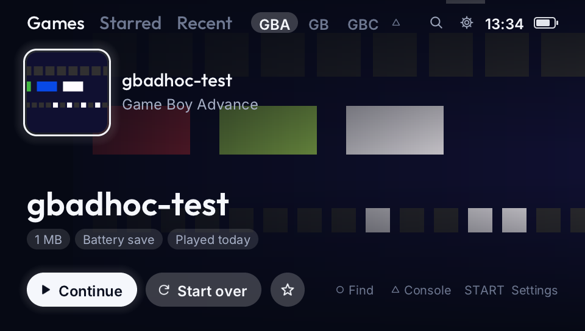 | 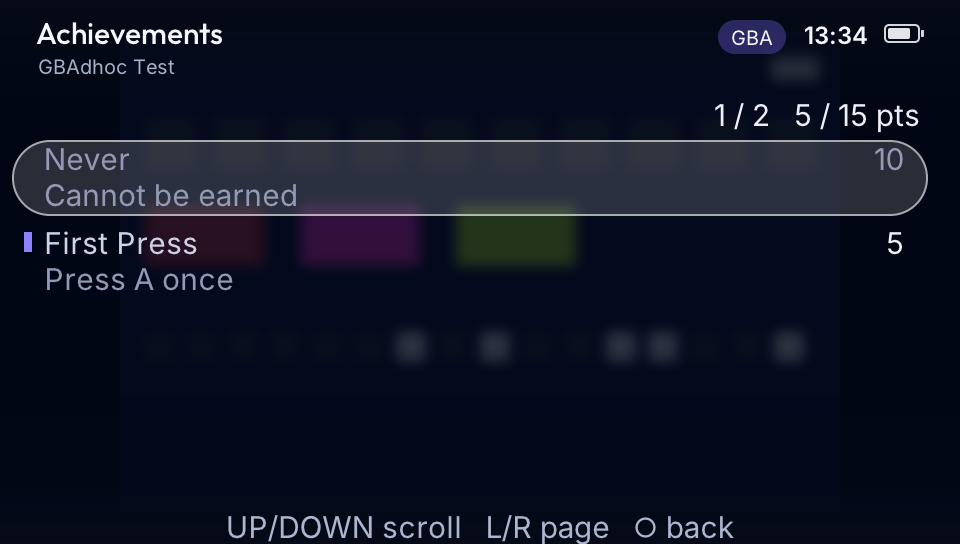 |
| **Recent** | **Motion games** |
| 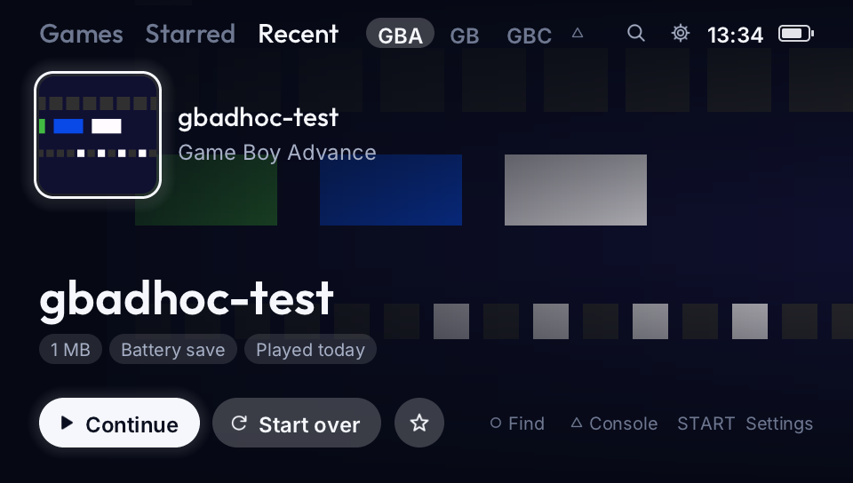 | 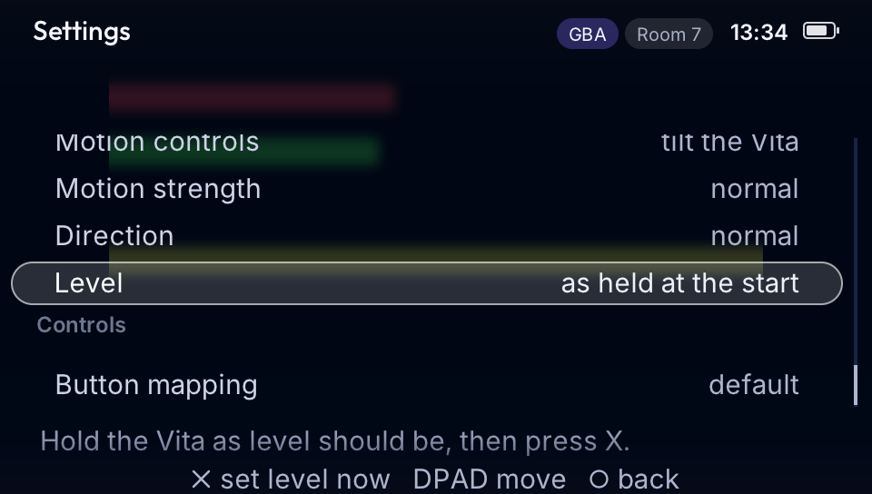 |
| **The in-game menu** | **Save states** |
| 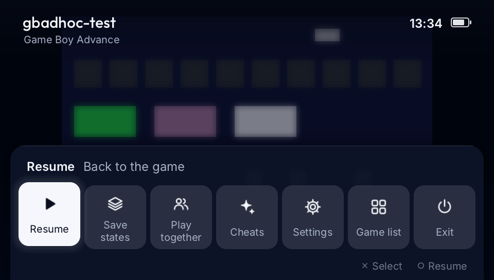 | 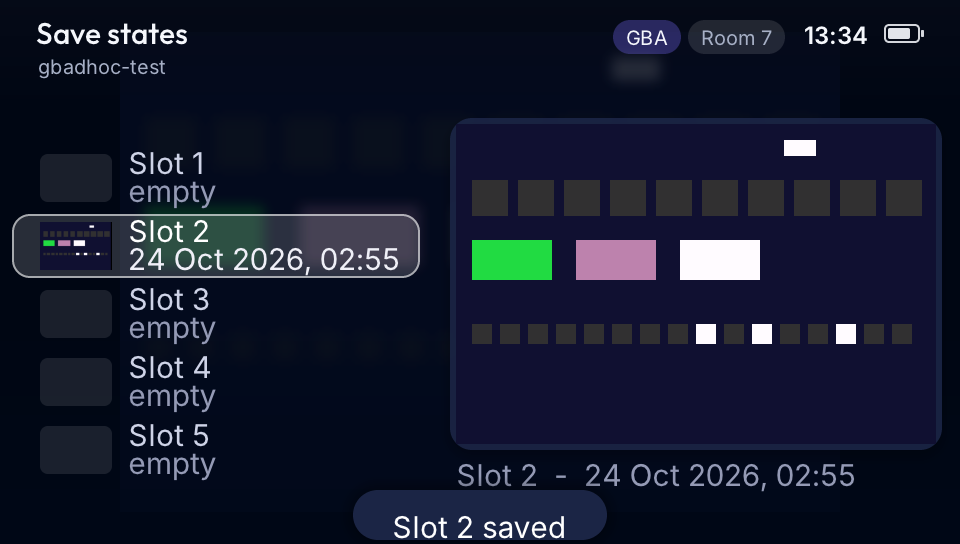 |
| **Two players on one Vita** | **Display settings** |
| 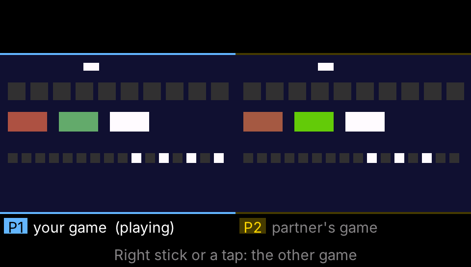 | 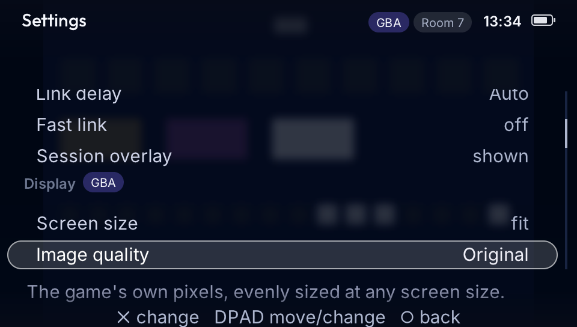 |
| **Starting a game** | |
| 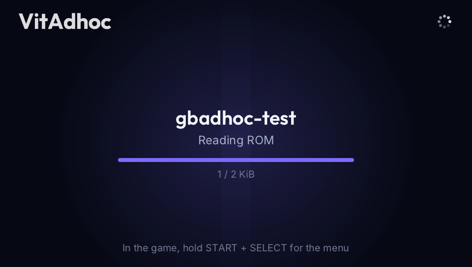 | |

Screens from the app's computer test build, with the project's own test
cartridges.

## Install

**What you need:** a PS Vita with HENkaku or Ensō, VitaShell, and your own
`.gba`, `.gb` or `.gbc` games.

**Easy way: CBOC Vita Installer.** Open the
[CBOC Vita Installer](https://github.com/CBOC-Vita-Lab/vita-installer/releases)
on your computer, give it this page's link (or the VPK) and add your games if
you like. It finds the Vita and does the rest. See [Desktop Install](DESKTOP-INSTALL.md).

**Manual way:**

1. Copy `VitAdhoc.vpk` to your Vita (VitaShell, over USB or FTP) and install it.
2. Start VitAdhoc once. It creates `ux0:data/GBAdhoc/`.
3. Put your games in `ux0:data/GBAdhoc/roms/`, or leave them in `ux0:ROMS/`
   or your RetroFlow folders: those are found automatically.
4. Start it again and pick a game.

**Updating?** Just install the new VPK over the old one. Your games, saves,
states and settings stay where they are.

## Playing

| Button | Does |
| --- | --- |
| Cross / Circle | A / B |
| Hold Start + Select, or tap the screen | Open the menu: save states, link play, cheats, settings |
| Square | Fast forward |
| Right stick left, or Select + Square | Rewind |
| Select + L / Select + R | Quick save / quick load |
| Triangle (home screen) | Switch between GBA, GB and GBC |
| Select (home screen) | All games, Starred, Recent |

Press Start on the home screen for Settings. Every button can be changed in
Settings > Controls. [Controls](CONTROLS.md) has the full list and
[Play Together](PLAY-TOGETHER.md) the two-player setup.

## Download Contents

| File | What it is |
| --- | --- |
| `VitAdhoc.vpk` | The app. Install it on your Vita. |
| `VitAdhoc-install.zip` | The VPK plus the guides, checksums and complete source. |

## For Developers

| | |
| --- | --- |
| [Building](docs/BUILDING.md) | Build the VPK and run the tests |
| [Technical notes](docs/TECHNICAL.md) | How it works, switches, and each version's engineering changes |
| [Source record](docs/SOURCE.md) | What this release was built from |
| [Licensing](LICENSING.md) · [Assets](docs/ASSETS.md) · [Notices](notices/THIRD-PARTY.md) | Licences and third-party components |
| [Check a download](docs/CHECK-DOWNLOAD.md) | Verify files against `SHA256SUMS` |

The app is in `gpsp/vita/`; the emulator cores and shared frontend are in
`gpsp/`.

## Credits

Built by AI agents (Claude), directed and play-tested by a human. VitAdhoc
stands on [GBAdhoc by ShoshinFauteux](https://github.com/ShoshinFauteux/GBAdhoc),
gpSP by Exophase and the libretro contributors, TGB Dual,
[rcheevos](https://github.com/RetroAchievements/rcheevos) and the other
projects in [Credits](CREDITS.md).

An unofficial fan project, not affiliated with Nintendo, Sony or
RetroAchievements.
