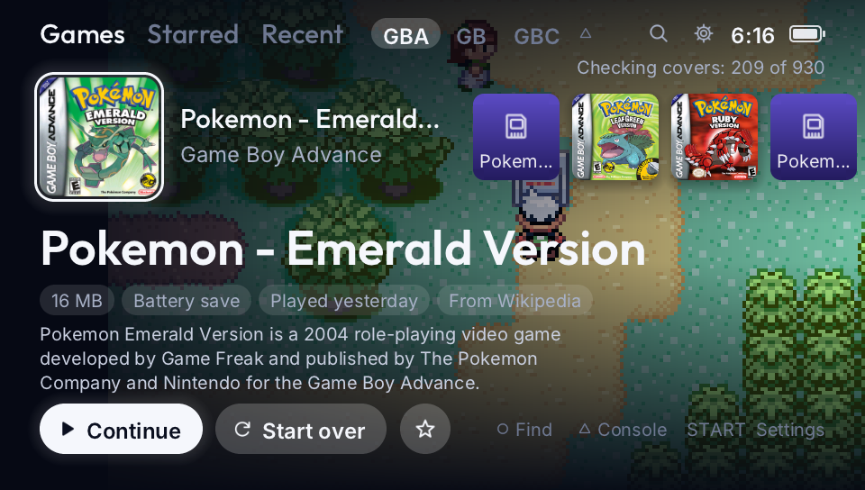
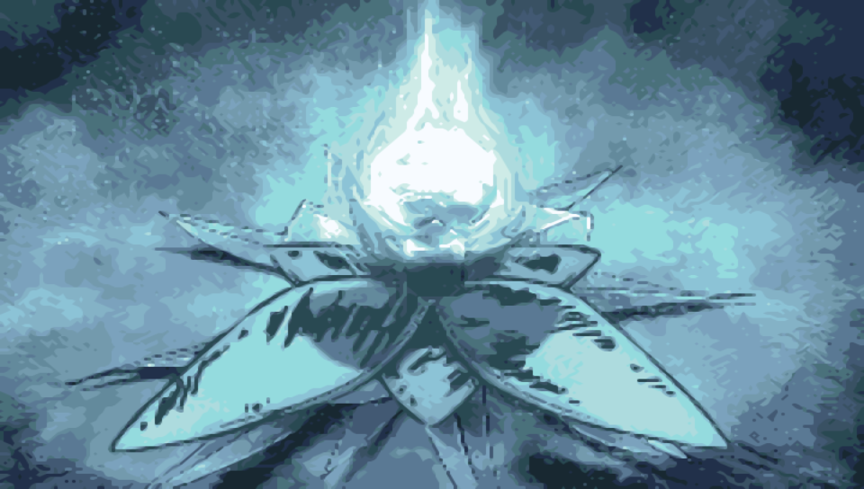
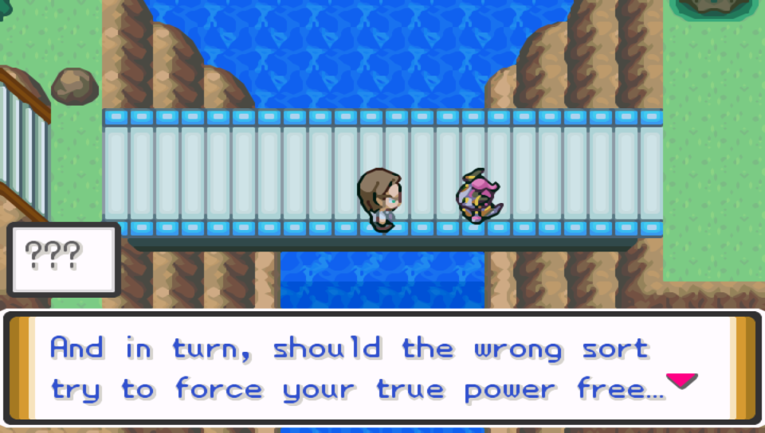
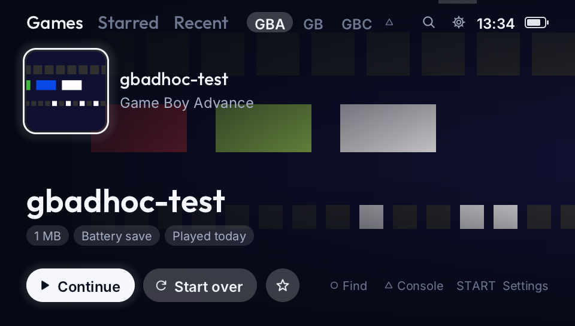
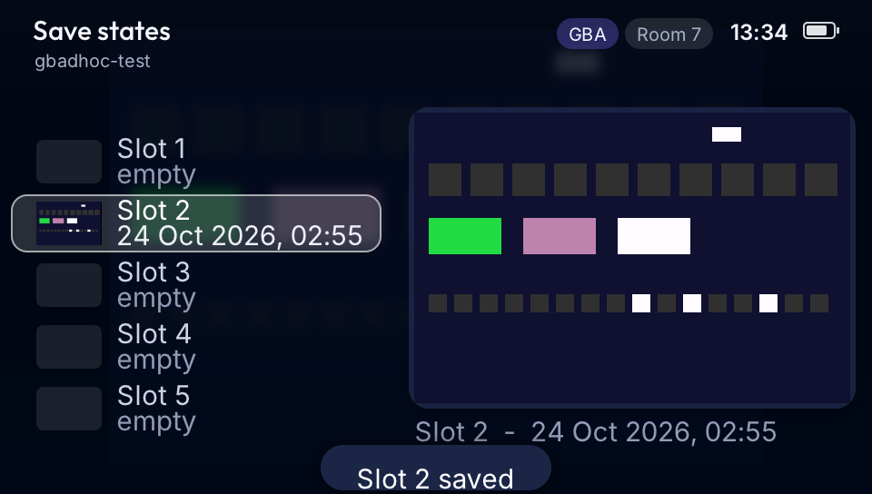
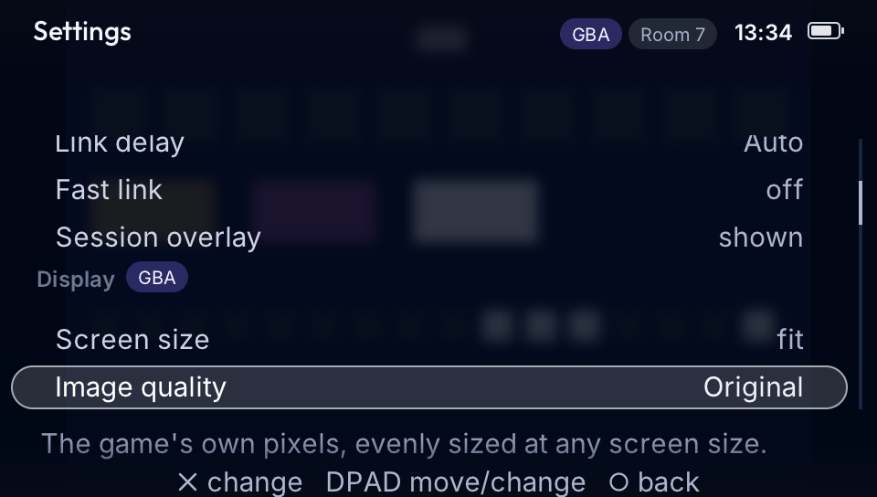
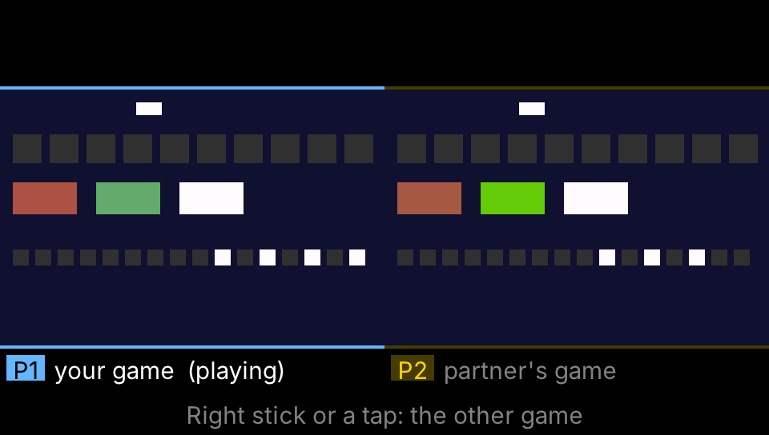

# VitAdhoc

**Game Boy Advance, Game Boy and Game Boy Color, native on PS Vita.**

Your games, together on a home screen with box art, a little history and
previews of your own play. Pick up where you left off, smooth the pixels or
keep them crisp, and trade with a friend. VitAdhoc brings the library and the
handheld experience together, with touch controls and the Vita's own sensors.

**[Download VitAdhoc 1.2](https://github.com/CBOC-Vita-Lab/vitadhoc/releases/latest/download/VitAdhoc.vpk)**
| [Install or update](INSTALL.md) | [All features](docs/FEATURES.md)
| [Performance](docs/PERFORMANCE.md)

*The home screen on a PS Vita running VitAdhoc 1.2.*

You'll need your own games. An open-source GBA BIOS is built in; no BIOS
download is required. Updating from 1.0 or 1.1? Install the VPK over the old
version. Keep your games, saves, settings and artwork where they are.

## New In Version 1.2

**Bring your saves, your folders and your zips.**

- **Bring an existing save.** Pick up a RetroArch battery save automatically,
  or put one in the `import` folder. An existing VitAdhoc save is not replaced.
- **Play zipped games.** Supported `.zip` files appear under the right console.
- **Choose your game folders in Settings.** Add or remove folders without
  editing a configuration file.
- **Launch straight into a game** from RetroFlow or another launcher.
- **Ten save-state slots**, up from five, with previews.
- **Make the screen your own.** PNG overlays, adjustable LCD/scanline strength
  and a screenshot folder of your choice.
- **Graphics fixes and a lighter rewind.** Safer texture handling, recovery from graphics
  errors and less repeated work in the rewind and smoothing paths.
- **More reliable everyday use.** Readable accented game names and safer
  settings writes when a memory card refuses a rename or write.

## Included From Version 1.1

**Better sound across GBA, GB and GBC.**

- Steadier playback through fixed, aligned double buffers.
- Correct stereo, note lengths, volume envelopes and sweep for GBA's
  Game Boy-style tone channels.
- GBA DirectSound FIFO resets clear old samples and reset the read/write
  positions together.
- Smoother startup, pause, resume and state-load transitions, with fades
  based on the last sample played and proper audio-channel cleanup on exit.

[Release changelog](CHANGELOG.md) | [Feature guide](docs/FEATURES.md)

## Features

### A library made for the Vita

Browse with buttons or touch. Box art and title screens download on Wi-Fi;
your own pictures take priority, and any game can have a cover you choose
(the Cover button, or a picture in `covers/` named like the game). Built-in descriptions cover about 1,300
games. Star favourites, search by name, check Recent and play time, or rest on
a game to watch the last ten seconds you recorded.

Continue returns to an automatic resume point. Start over uses the game's
battery save instead. Existing `ux0:ROMS/` and RetroFlow folders can stay in
place, alongside folders you add yourself.

### More ways to see and play

- Original pixels, bilinear and sharp-bilinear scaling, CPU xBRZ or Scale3x.
- Colour correction, motion blending, LCD/scanline looks, screen sizes,
  Super Game Boy borders and your own PNG overlays.
- Wide view with profiles for supported games, including the original
  Pokemon Emerald family.
- Rewind, fast forward, ten save-state slots, turbo buttons and screenshots.
- IPS, BPS and UPS soft patches, without changing the original game file.
- RetroAchievements, including Hardcore mode for supported games.
- Motion and sunlight cartridge support: Twisted!, Yoshi, Koro Koro,
  Kirby Tilt 'n' Tumble and Boktai, with sensor or stick settings.

### Play together

GBA Link Cable and Wireless Adapter support, plus GB/GBC linking: two Vitas
over Wi-Fi, internet or ad hoc, or two emulated handhelds side by side on one
Vita. Save/state sharing and a Mystery Gift receiver are included too.

[Play Together](PLAY-TOGETHER.md) has the setup guide and supported modes.

## Performance

**CPU speed (1.3):** VitAdhoc asks for 500 MHz (Settings > CPU speed). The
system only allows that with an overclock plugin such as PSVshell; otherwise
the Vita stays at 444 MHz. A faster clock means a warmer Vita and shorter
battery life; choose "444 MHz (standard)" to go back.

**Pokemon Unbound 2.1.1.1 on a real Vita:** about **60 emulated fps** and
**44 frontend-produced frames/s** across three samples of the opening beach
scene, at full-screen CPU xBRZ 3x.

[Full results, settings and screenshots](docs/PERFORMANCE.md).

## Bug Fixes Since 1.0

- Recovery from a graphics error that could leave the picture frozen.
- Safer smoothing and staging textures, deferred GPU frees and fallback
  handling when texture allocation fails.
- Audio improvements from 1.1: persistent buffers, stereo routing, timing,
  fades and state-load cleanup.
- Accented Latin names fold to readable letters in the menu font.
- Safer settings writes when a memory card refuses a rename or write.

See the [changelog](CHANGELOG.md) for the player-facing changes and
[technical notes](docs/TECHNICAL.md) for the implementation details.

## Install

You need a homebrew-enabled PS Vita, VitaShell and your own games.

1. Transfer `VitAdhoc.vpk` with VitaShell over USB or FTP, then install it.
2. Start VitAdhoc once to create `ux0:data/GBAdhoc/`.
3. Add games to `ux0:data/GBAdhoc/roms/`, use an automatically detected folder,
   or choose **Settings > Library > Game folders**.
4. Pick a game and press Cross. Triangle switches GBA, GB and GBC.

For the desktop installer, update precautions, save import, launchers and
every folder, use the [manual install guide](INSTALL.md).

## Playing

| Button | Default action |
| --- | --- |
| Cross / Circle | A / B (Circle is A on a Vita whose Enter button is Circle, or in Settings) |
| Hold Start + Select, or tap the game | Open the menu |
| Square | Fast forward |
| Select + Square | Rewind (right stick left too, if turned on in Settings) |
| Select + L / Select + R | Quick save / quick load |
| PS + Start | The Vita's own screenshot |
| Start on the home screen | Settings |

[All controls](CONTROLS.md) | [Detailed features and settings](docs/FEATURES.md)
| [Troubleshooting](KNOWN-ISSUES.md)

## Screenshots

Pokemon Unbound on a PS Vita, full-screen with CPU xBRZ 3x.

| Pokemon Unbound 2.1.1.1: opening scenes on a PS Vita | Full-screen, CPU xBRZ 3x |
| --- | --- |
|  |  |

[Capture details](store/screenshots/vita-1.2/README.md).

The following images show the computer test build with the project's test
cartridges.

| Continue | Save states |
| --- | --- |
|  |  |
| **Display settings** | **Two players** |
|  |  |

## Download Contents

| File | Contents |
| --- | --- |
| `VitAdhoc.vpk` | The app to install on a Vita. |
| `VitAdhoc-install.zip` | The same VPK, manual, checksums and complete source. |
| `cboc-release.json` | Package metadata for the desktop installer. |
| `SHA256SUMS` | Checksums for the extracted source/install files. |

## For Developers

[Building and tests](docs/BUILDING.md) | [Technical notes](docs/TECHNICAL.md)
| [Source record](docs/SOURCE.md) | [Check a download](docs/CHECK-DOWNLOAD.md)
| [Licensing](LICENSING.md) | [Assets](docs/ASSETS.md)
| [Third-party notices](notices/THIRD-PARTY.md)

The native frontend is in `gpsp/vita/`; emulator cores and shared frontend
code are in `gpsp/`.

## Credits

VitAdhoc builds on [GBAdhoc by ShoshinFauteux](https://github.com/ShoshinFauteux/GBAdhoc).
Thank you for the emulator, link-play work and original save formats this
project builds on. The GBA core is gpSP by Exophase and the libretro
contributors; GB/GBC uses TGB Dual. RetroAchievements uses
[rcheevos](https://github.com/RetroAchievements/rcheevos).

Built by AI agents (Claude), directed and play-tested by a human. See
[Credits](CREDITS.md) for the other projects and contributors.

An unofficial fan project, not affiliated with Nintendo, Sony or
RetroAchievements. No commercial games or proprietary BIOS are supplied.
