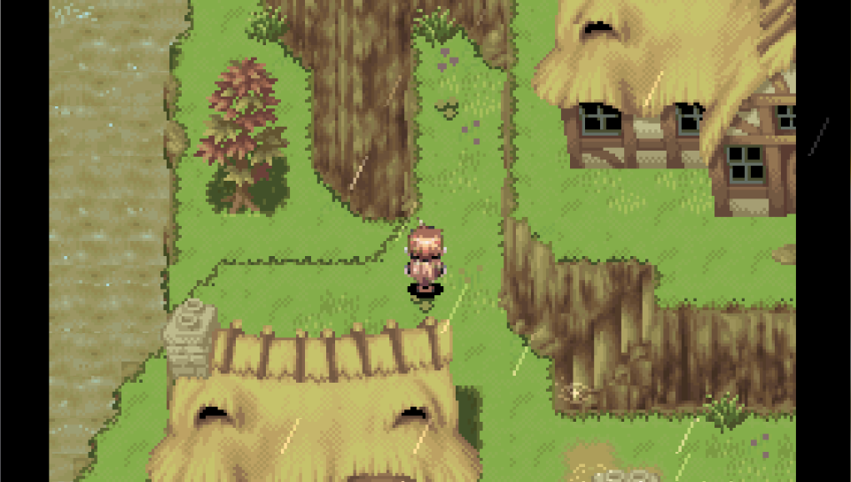
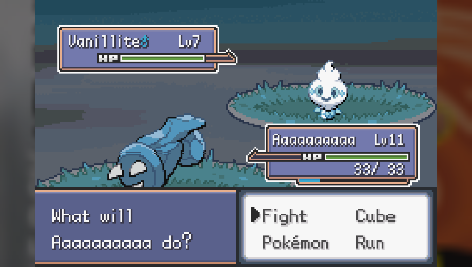

# VitAdhoc 2.0

**11 retro consoles. True 16:9 Wide View at 60 fps. Room-code online play. Native on PS Vita.**

[Download Latest VPK](https://github.com/CBOC-Vita-Lab/vitadhoc/releases/latest/download/VitAdhoc.vpk) ·
[Install Guide](INSTALL.md) ·
[Controls](CONTROLS.md) ·
[Play Together](PLAY-TOGETHER.md) ·
[Online Play](docs/ONLINE.md) ·
[Benchmarks](docs/PERFORMANCE.md) ·
[Changelog](CHANGELOG.md)

  
   
  Real PS Vita 960×544 capture — 11-console Triangle picker, automatic box art, Wikipedia blurbs, and live Keep-Alive cover checking.

| GBA Wide View (Locked 60 fps) | GBA ROM Hacks at Locked 60 fps | GBC Default 4x xBRZ Supersampling |
| :---: | :---: | :---: |
|  |  |  |
| *Golden Sun* filling 16:9 with zero pixel stretch | *Pokemon Unbound* Battle: **34.08 → 60.0 fps** | `cgb-acid2` (Gambatte): `640×576 → 604×544` Fit |

---

## Why VitAdhoc 2.0

VitAdhoc is built specifically for the PS Vita — one native launcher, one consistent menu layout across every system, automatic covers and gameplay previews, and best-looking visual defaults out of the box. Drop in your games and play at 60 fps, or share a **5-character room code** to link up with a friend anywhere over Wi-Fi or a phone hotspot without router settings or accounts.

- **11 consoles, one native home screen:** Press **Triangle** to switch between GBA, GB, GBC, NES / Famicom, WonderSwan / Color, SNES, Genesis / Mega Drive, Sega CD / Mega CD, Master System, Game Gear, and SG-1000.
- **Online multiplayer by 5-character room code (`vitadhoc.psvita.dev`):** Direct UDP P2P first with automatic Cloudflare TURN relay fallback (plus an **Always use the relay** privacy toggle). Covers GBA Link Cable (including cross-version Ruby/Sapphire & FireRed/LeafGreen trades with cached cartridge transfer and an in-app cartridge picker), GBA Wireless Adapter, GB/GBC Link Cable (including Gen 1/2 Time Capsule), Save & State Sharing, and 2P play on NES, WonderSwan, SNES, Genesis, Sega CD, Master System, and SG-1000. Same Wi-Fi, Ad-Hoc (Nearby), same-console 2P split screen, and GBA Mystery Gift are all built in.
- **Zero-stretch 16:9 Wide View:** Keeps the original game sharp in the center and fills the sides with real extended tilemaps/nametables, learned level data, or soft edge continuation. GBA defaults to `On + any game` with Soft edges; NTSC NES fills **`956×544`** full height at Fit with zero letterbox bars; SNES and Sega run Wide View Auto at 60 fps.
- **Smart Auto visuals with 60 fps protection:** Defaults to Fit screen, Ambient Glow (5/10), Wide View Auto, and governed **Image quality: Auto** (including **4x xBRZ supersampling** on GB/GBC, 3x xBRZ on GBA/WonderSwan, 2x xBRZ/MMPX on NES Wide View, and NEON xBR/MMPX on SNES and Sega). The per-frame Look Governor trims smoothing only if frame headroom gets tight and restores it when scenes lighten. Unified 0–10 sliders for **Ambient glow**, **Scanlines**, **LCD grid**, **CRT mask**, and **LCD ghosting**, authentic console colour profiles, **GBC Auto** palettes for GB games, an **OLED (PCH-1000)** colour profile, and **Smooth 50 Hz** PAL mode.
- **Built for real PS Vita hardware:** Generic GBA self-modifying code cache (`SMCR_MAXVER=256`, MTF LRU, `src_hash`, `1.5 MiB` carve) speeds up *Pokemon Unbound*, *Radical Red*, *Inclement Emerald*, and official SMC titles with 100% bit-exact accuracy. Fixed SNES/Genesis 60 fps pacing and Core 0 scaler wakeups. Eliminated Vita FAT32 cold-boot, launch, cover-checking, and menu-browsing stalls.
- **Loaded with everyday features:**
  - Optional cycle-accurate **Gambatte** core for GB/GBC alongside upgraded TGB Dual (11/11 `cpu_instrs`, `dmg-acid2`, `cgb-acid2`, 13/13 sound tests).
  - **Quick Response** (1-frame run-ahead) on GB/GBC, NES, WonderSwan, SNES, and Sega.
  - **RetroAchievements** across all 11 systems (Hardcore mode, live progress counters, near-unlock markers, leaderboards, and in-game Achievements viewer in SNES and Sega).
  - **7,005-game built-in cheat database** (151,936 cheats) plus live on-console **Search memory** (including GBC banked WRAM) on every system.
  - **Ten save-state slots** with thumbnails, **Slot Lock (`L`)**, and persisted **Undo (`R`)**; automatic pre-overwrite save backups, **two-way RetroArch save sync**, and on-demand **Export save**.
  - Right-stick **Rewind / Fast Forward** (with **normal-pitch audio**) on by default everywhere.
  - Custom **Collections**, **Most played / Not played yet**, read-only **RetroArch & Emu4Vita++ `.lpl` playlists**, full **`.7z`** support alongside `.zip`, **Game title vs File name** toggle, **Save Clip** (10s animated PNG), **Game Boy Camera & Printer**, touch-screen **NES Zapper**, **Sega CD `.m3u`** multi-disc swap, **Rear Touch** mapping (12% grip inset), **Button Test**, synced **Light / Dark theme**, **Large text & High contrast**, **8 UI languages** (full CJK/Korean/Greek/Cyrillic text rendering), and daily opt-out GitHub **Update check**.

---

## Supported Consoles

| Console | Core | Formats | Default Visuals | Multiplayer |
| --- | --- | --- | --- | --- |
| **Game Boy Advance** | gpSP (ARMv7 dynarec + SMC cache) | `.gba`, `.zip`, `.7z` | Wide View (`On + any game`, Soft edges), xBRZ Auto (up to 3x) | Online, Wi-Fi, Nearby, Split Screen (Link Cable + Wireless Adapter + Mystery Gift) |
| **Game Boy / GBC** | TGB Dual + optional **Gambatte** | `.gb`, `.gbc`, `.zip`, `.7z` | **4x xBRZ supersampling** (`640×576 → 604×544` Fit), GBC Auto palettes, Ambient Glow | Online, Wi-Fi, Nearby, Split Screen (incl. Gen 1/2 cross-link) |
| **NES / Famicom** | FCEUmm | `.nes`, `.fds`, `.unf`, `.unif`, `.zip`, `.7z` | Full-height **`956×544`** NTSC Wide View, 2x xBRZ / MMPX / Sharp Bilinear | Online, Wi-Fi, Nearby (2P) + touch-screen NES Zapper |
| **WonderSwan / Color** | Beetle WonderSwan | `.ws`, `.wsc`, `.pc2`, `.zip`, `.7z` | Auto portrait/landscape rotation, 75→60 Hz blending, xBRZ Auto (up to 3x) | Online, Wi-Fi, Nearby (2P) |
| **Super NES** | Snes9x 1.63 + fast exact Super FX (`snes.bin`) | `.sfc`, `.smc`, `.zip`, `.7z` | Wide View Auto, NEON xBR / MMPX Auto, Smooth 50 Hz PAL | Online, Wi-Fi (2P) |
| **Genesis / Mega Drive** | Genesis Plus GX (`md.bin`, dedicated FM core) | `.md`, `.gen`, `.smd`, `.68k`, `.bin`, `.zip`, `.7z` | Wide View Auto, NEON xBR 2x / MMPX Auto, 6-button default | Online, Wi-Fi (2P) |
| **Sega CD / Mega CD** | Genesis Plus GX (`md.bin`, disc read-ahead) | `.cue`+`.bin`, `.iso`, `.chd`, `.m3u` | Wide View Auto, NEON xBR / MMPX Auto, in-game disc tray swap | Online, Wi-Fi (2P single-disc) |
| **Master System / Game Gear / SG-1000** | Genesis Plus GX (`md.bin`) | `.sms`, `.gg`, `.sg`, `.sc`, `.zip`, `.7z` | Wide View Auto, NEON xBR (auto 3x→2x), optional No sprite flicker, GG LCD profile | Online, Wi-Fi (2P on SMS / SG-1000) |

> An open-source GBA BIOS is built in, so no BIOS download is needed for cartridge consoles. Supply your own region BIOS only for **Sega CD** (`ux0:data/GBAdhoc/bios/`) and **Famicom Disk System** (`disksys.rom`).

---

## Measured on Real PS Vita Hardware

All results below were logged on a physical PS Vita running VitAdhoc `2.0` (500 MHz via PSVshell, 4-core Auto; runs at 444 MHz stock without PSVshell). Full telemetry is in [docs/PERFORMANCE.md](docs/PERFORMANCE.md).

| Benchmark / Title | Before (`2.0 rc6`) | After (`2.0`) | Highlight |
| --- | --- | --- | --- |
| **Cold boot → interactive Home Screen** | 5,000+ ms | **55.8 ms** (23 ms 1st frame) | Lazy `cheats.db` init (**4,880 → 0.016 ms**); 2,886 ROMs across 11 systems scanned in **2.74 s** |
| **Menu browsing & game landing** | Visible hang (25 `stat`s/game) | **0 UI waits / 0 GPU blocks** | 1 `stat`/game, 1.0 ms max GPU upload, CDRAM recycling, D-pad tap latching |
| **Cover checking (live Vita Wi-Fi)** | Serial TLS/HTTP | **249 / 930 checked in ~10 s** | Persistent HTTP/1.1 Keep-Alive, O(1) index, box-art-first two-pass fetch |
| **NES launch (1,091-ROM folder, *SMB 3*)** | >40 s freeze | **3.6 s cold / 0.88 s warm** | **45x faster** warm launch (`sidecar_migrate` cache + `art_dir_cache`) |
| **GBA launch (925-ROM folder, *Golden Sun*)** | ~18.4 s | **2.87 s** | Same FAT32 launch-path fixes |
| **GBA ROM hack (*Pokemon Unbound* Battle)** | 34.08 fps (`jit=10.69 ms`, 531 reclaims) | **Locked 60.0 fps** (`jit=0.051 ms`, **0 reclaims**) | Generic SMC cache (**209x less JIT time**, 100% bit-exact; applies to *Radical Red*, *Inclement Emerald*, etc.) |
| **GBA (*Unbound* Town, *Golden Sun*, *Mario Golf*)** | 48.21 fps (Town) | **Locked 60.0 fps** | 0% missed frames, Wide View Auto active |
| **SNES SA-1 (*Super Mario RPG*, Wide View)** | 28.8 fps | **59.8–59.9 fps** | `over=0`, `max=5.8–9.9 ms`, LookGovernor + Core 0 scaler wakeup fix |
| **SNES Super FX 2 (*Yoshi's Island*, Wide View)** | 30.0 fps | **Locked 59.9 fps** | `over=0`, `max=7.7 ms`, fast exact Super FX block cache |
| **SNES Mode 7 (*Super Mario Kart*, Wide View)** | 30.0–46.0 fps | **Locked 60.0 fps** | `over=0`, `max=4.2–4.4 ms`, 92% Wide View cover |
| **Genesis (*Gunstar Heroes*, Wide View + `xBR 2x`)** | 30.0 fps | **Locked 60.0 fps** | **`xBR 2x` AND Wide View both active**, dedicated FM core |
| **Genesis (*Sonic the Hedgehog 2*, Wide View)** | 30.0 fps | **59.0–60.0 fps** | `emu_fps=60.0`, `over=0` |
| **NES (*Super Mario Bros. 3*, `956×544` Wide View)** | Letterboxed | **Locked 60.0 fps** | Full-height Fit + `2x xBRZ` in 1.17 ms avg |
| **GBC (`cgb-acid2`, Gambatte Accurate, `4x xBRZ`)** | 3x cap | **Locked 60.0 fps** | `4x xBRZ` in 0.106 ms avg, 21% load |

Online `vitadhoc.psvita.dev` room & Cloudflare relay backend is live and verified (`138/138` automated + `9/9` live relay smoke); multi-console two-Vita internet play, Sega CD disc streaming, NES Zapper calibration, and Game Boy Camera hardware timing remain open for community feedback in [Known Issues](KNOWN-ISSUES.md).

---

## Install or Upgrade

You need a homebrew-enabled PS Vita (or PS TV), VitaShell, and your own game backups.

- **Easiest way:** Drop `VitAdhoc.vpk` onto the [CBOC Vita Installer](DESKTOP-INSTALL.md) on desktop — it finds your Vita and installs cleanly.
- **Manual install:**
  1. Copy `VitAdhoc.vpk` to your Vita via VitaShell (USB or FTP) and install it.
  2. Launch VitAdhoc once to create `ux0:data/GBAdhoc/`.
  3. Put games in `ux0:data/GBAdhoc/roms/` or any folder under `ux0:ROMS/` (`GBA`, `GB`, `GBC`, `NES`, `WS`, `SNES`, `MD`, `SMS`, `GG`, `SG-1000`, `SegaCD`). Existing RetroFlow folders are detected automatically.
  4. Launch VitAdhoc, press **Triangle** to switch consoles, and press **Cross** to play.
- **Upgrading from v1.x:** Install `VitAdhoc.vpk` directly over your existing bubble (`GBAD00001`). Do **not** uninstall first — all ROM paths, battery saves, save states, covers, and settings stay intact. (Backing up `ux0:data/GBAdhoc/` first is still good practice.) See the [full install guide](INSTALL.md).

---

## Default Controls

| Input | Default Action |
| --- | --- |
| **Cross / Circle** | A / B (follows your Vita's Enter button; WonderSwan always uses physical Circle = A, Cross = B) |
| **Hold Start + Select** (or tap screen) | Open in-game menu (`Start` resumes in SNES and Sega) |
| **Right Stick Right / Square** | Fast forward (2x, 3x, Unlimited, Unlimited Smooth, normal-pitch audio) |
| **Right Stick Left / Select + Square** | Rewind (enabled by default on all 11 consoles) |
| **Select + L / Select + R** | Quick save / quick load |
| **L / R** *(Save states page)* | Lock or unlock slot / Undo last load or overwrite |
| **Triangle / Square / Start** *(Cheats page)* | Add cheat / Delete custom cheat / Search memory |
| **Triangle** *(Home screen)* | 11-console picker |
| **Start** *(Home screen)* | Settings & RetroAchievements |

Genesis defaults to 6-button layout (`Square`/`Cross`/`Circle` = A/B/C, `L`/`Triangle`/`R` = X/Y/Z). Full bindings: [CONTROLS.md](CONTROLS.md) · [docs/FEATURES.md](docs/FEATURES.md).

---

## Release Downloads & Verification

| File | Contents |
| --- | --- |
| `VitAdhoc.vpk` | Native PS Vita package (`GBAD00001`, `APP_VER 02.00`) |
| `VitAdhoc-install.zip` | Same VPK plus complete source tree, guides, and checksums |
| `cboc-release.json` | Release manifest for CBOC Vita Installer |
| `SHA256SUMS` | File verification checksums for every tracked file |

---

## For Developers

| | |
| --- | --- |
| [Building and tests](docs/BUILDING.md) | [Technical notes](docs/TECHNICAL.md) |
| [Source record](docs/SOURCE.md) | [Check a download](docs/CHECK-DOWNLOAD.md) |
| [Licensing](LICENSING.md) | [Third-party notices](notices/THIRD-PARTY.md) |

The main app lives in `gpsp/vita/` (GBA, GB/GBC, NES, and WonderSwan cores). The Super NES player (`snes/`) and Sega player (`md/`) are separate executables kept apart because of their non-commercial licenses. The shared MIT kits are `playerkit/` and `widekit/`, and the online room service lives in `online/service/`.

## Credits

Built by AI agents (Claude), directed and play-tested by a human. VitAdhoc builds on [GBAdhoc by ShoshinFauteux](https://github.com/ShoshinFauteux/GBAdhoc) and these open-source projects: gpSP (GBA), TGB Dual and Gambatte (GB / GBC), [FCEUmm](https://github.com/libretro/libretro-fceumm) (NES), Beetle WonderSwan from Mednafen, [Snes9x](https://github.com/snes9xgit/snes9x) (SNES), [Genesis Plus GX](https://github.com/ekeeke/Genesis-Plus-GX) (Sega), [rcheevos](https://github.com/RetroAchievements/rcheevos) (RetroAchievements), and [Mbed TLS](https://github.com/Mbed-TLS/mbedtls) (online play). `playerkit` and `widekit` are ours. Snes9x and Genesis Plus GX allow non-commercial use only, so VitAdhoc is and stays free. Game descriptions are adapted from Wikipedia (CC BY-SA 4.0). See [Credits](CREDITS.md) for everyone else.

*An unofficial fan project, not affiliated with Nintendo, Sega, Bandai, or Sony. No commercial games or proprietary BIOS files are included.*
