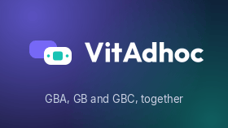

# VitAdhoc

Included LiveArea artwork, not a gameplay screenshot.

Game Boy Advance, Game Boy and Game Boy Color on PS Vita, based on GBAdhoc
and gpSP. It uses a native Vita frontend, with touch menus, a game browser
and two-player link modes.

## Highlights

- Browse GBA, GB and GBC libraries without moving existing ROM folders.
  Build 21 adds external folders, including common RetroFlow locations.
- Use five save-state slots, rewind, remappable controls and optional turbo
  buttons. Battery saves stay beside their games.
- Choose integer scaling, fit or stretch, colour correction, frame blending,
  Scale3x or CPU xBRZ. GBA wide-view options are available for supported games.
- Open the included cheat database and offline game descriptions without
  downloading a separate pack. Games, covers and Nintendo's BIOS are not included.
- Link two Vitas or run two emulated handhelds on one Vita.
  See [Play Together](PLAY-TOGETHER.md) for the setup.

## Install

**Private source preview.** [Releases](https://github.com/CBOC-Vita-Lab/vitadhoc/releases)
contains `VitAdhoc-build21-source-20261019.zip`, not a ready-made installer.
The newer covers runtime still needs matching source and license clarification;
do not replace it with this earlier build-21 version.

New to the package? Open [Start Here](START-HERE.txt).

You need a homebrew-enabled PS Vita, VitaShell and games you may lawfully use.
No BIOS download is required; an open replacement is built in.

1. If you already have the matching private-preview `VitAdhoc-build21.vpk`, install it with VitaShell.
2. Start VitAdhoc once to create `ux0:data/GBAdhoc/`.
3. Put `.gba`, `.gb` and `.gbc` files in `ux0:data/GBAdhoc/roms/`, or use an
   [existing ROM folder](INSTALL.md#existing-rom-folders).

Back up saves before updating, including saves beside games in external
folders. [Install](INSTALL.md) covers paths, optional art and troubleshooting.

The source includes the open BIOS, databases, app artwork and guides.
Build 21 remains a private preview; [Known Issues](KNOWN-ISSUES.md) has the
testing and release notes.

[Manual installation](INSTALL.md) has the exact paths and update steps.
[Building](BUILDING.md) and [Technical notes](TECHNICAL.md) are the advanced route.

[Controls](CONTROLS.md) | [Technical Notes](TECHNICAL.md) |
[Building](BUILDING.md) | [Assets And Licenses](ASSETS.md) |
[Changes](CHANGELOG.md) | [Source Record](SOURCE.md)

CBOC, Claude and ChatGPT contributed to this release preparation; full roles
and upstream acknowledgments are in [Credits](CREDITS.md). Code and databases
retain their separate licenses.
