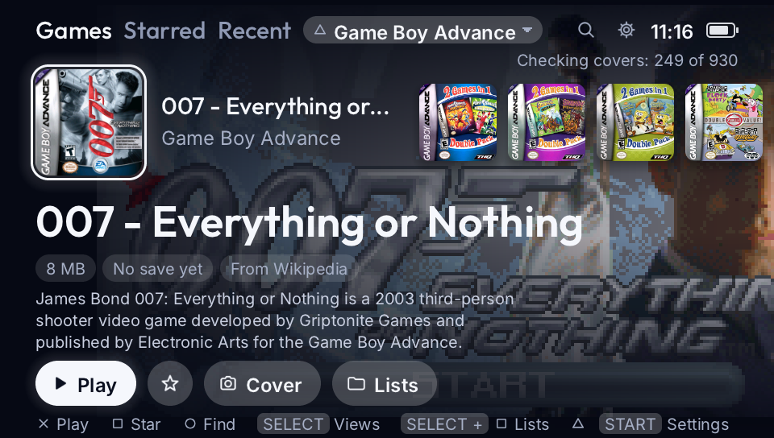
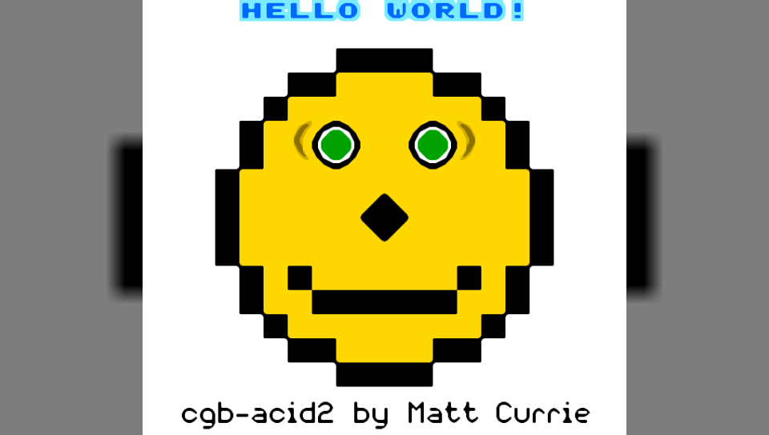

# VitAdhoc

**One app, eleven consoles, native on your PS Vita.** Game Boy Advance, Game Boy,
Game Boy Color, NES / Famicom, WonderSwan / Color, Super NES, Genesis / Mega Drive,
Sega CD / Mega CD, Master System, Game Gear, and SG-1000 live together on one home
screen with automatic box art, descriptions, and gameplay previews. Pick up where
you left off, fill the Vita's `960x544` screen with true zero-stretch Wide View,
play at locked 60 fps with governed pixel-art upscaling, earn RetroAchievements,
and link up with a friend anywhere using a 5-character room code.

| GBA Wide View (60 fps) | GBA ROM Hack at 60 fps | GBC 4x xBRZ Supersampling |
| --- | --- | --- |
|  |  |  |

**[Download the latest version](https://github.com/CBOC-Vita-Lab/vitadhoc/releases/latest/download/VitAdhoc.vpk)**
· [Install guide](INSTALL.md) · [Controls](CONTROLS.md) · [Play together](PLAY-TOGETHER.md) · [What's new](CHANGELOG.md)

You'll need your own games. An open-source GBA BIOS is built in, so no BIOS
download is required for cartridge consoles (Sega CD and Famicom Disk System
`.fds` require your own BIOS files; see [Install](INSTALL.md)).

## New In Version 2.0

VitAdhoc 2.0 expands from 4 to **11 consoles**, adds room-code online multiplayer
on `vitadhoc.psvita.dev`, brings true 16:9 Wide View and smart Auto visuals to the
entire library, and delivers major real-hardware CPU and FAT32 speedups.

- **7 new consoles since v1.3.1:** **NES / Famicom** (`.nes`, `.fds`, `.unf`,
  `.unif`, plus touch-screen **NES Zapper**), **WonderSwan / Color** (automatic
  portrait/landscape rotation, 75 Hz-to-60 Hz blending, unswapped physical buttons),
  **Sega Genesis / Mega Drive**, **Master System**, **Game Gear**, **SG-1000**
  (with optional **No sprite flicker** on 8-bit Sega and dedicated-core Genesis FM
  sound), and **Sega CD / Mega CD** (`.cue`+`.bin`, `.iso`, `.chd`, and `.m3u`
  multi-disc swapping with disc read-ahead).
- **Online play by 5-character room code (`vitadhoc.psvita.dev`):** Host a game,
  share the code, and play with a friend anywhere with no port forwarding and no
  accounts. Direct UDP NAT hole-punching runs first with automatic Cloudflare TURN
  relay fallback (plus an optional **Always use the relay** toggle). Works for GBA
  Link Cable (including cross-version trades and in-app cartridge picker), GBA
  Wireless Adapter, GB/GBC Link Cable (including Gen 1/2 Time Capsule), save and
  state sharing, and 2P play on NES, WonderSwan, SNES, Genesis, Sega CD, Master
  System, and SG-1000. Same Wi-Fi, Ad-Hoc, and same-console split screen all remain
  supported.
- **True 16:9 Wide View (zero stretching):** GBA defaults to `On + any game` with
  Soft edges; NTSC NES Wide View fills `956x544` at full height with zero letterbox
  bars and 2x smoothing (`xBRZ 2x`, `MMPX 2x`, `Scale2x`) or Sharp Bilinear; SNES
  and Sega keep the native image pixel-exact in the center with real extended
  margins or soft edge continuation beside it.
- **Best-looking defaults with automatic 60 fps protection:** Fit screen, Ambient
  Glow (5/10), Wide View Auto, and governed **Image quality: Auto** across all 11
  systems. **GB / GBC** defaults to **4x xBRZ supersampling** (`640x576` down to
  `604x544`), GBA/WonderSwan start at 3x xBRZ, and SNES/Sega run NEON-accelerated
  xBR/MMPX. The per-frame Look Governor trims smoothing before a frame drops and
  restores it when scenes lighten. Unified 0-10 sliders for **Ambient glow**,
  **Scanlines**, **LCD grid**, **CRT mask**, and **LCD ghosting**, plus console
  colour profiles, **GBC Auto** palettes for Game Boy games, an **OLED (PCH-1000)**
  colour profile, and **Smooth 50 Hz** for PAL games.
- **Real-hardware speedups verified on PS Vita:**
  - **Generic GBA SMC cache upgrade (`SMCR_MAXVER=256`, MTF LRU, `src_hash`,
    1.5 MiB carve):** Removes dynarec recompilation thrashing in all self-modifying
    RAM GBA games and modern ROM hacks (`ipatix` `hq_mixer`, CFRU, `pokeemerald`
    hacks like *Pokemon Unbound* and *Radical Red*, plus official SMC titles), 100%
    bit-exact. *Pokemon Unbound* battles went from **34.08 fps to locked 60.0 fps**
    (209x less JIT compile time, zero cache reclaims).
  - **SNES & Genesis 60 fps tuning:** Fixed Core 0 scaler helper wakeups and
    calibrated the Look Governor so heavy titles (*Super Mario RPG*, *Yoshi's
    Island*, *Super Mario Kart*, *Gunstar Heroes*, *Sonic 2*) run at **59.8-60.0
    fps** with Wide View active (with `xBR 2x` + Wide View both active on *Gunstar
    Heroes*), alongside a faster exact Super FX block cache and ARMv7/NEON core
    optimizations.
  - **Fast Vita FAT32 boot, launches, covers, and menu browsing:** Interactive
    Home Screen in **55.8 ms** (lazy `cheats.db` init cut from 4,880 ms to 0.016 ms;
    2,886 ROMs across 11 consoles scanned in 2.74 s), large-folder launches up to
    **45x faster** (1,091-ROM NES folder from >40 s down to 3.6 s cold / 0.88 s
    warm), persistent **HTTP/1.1 Keep-Alive** cover checking (249 of 930 covers
    checked in ~10 s on Vita Wi-Fi), and zero menu-landing hangs with lock-free
    loader pools, CDRAM texture recycling, 1 GPU upload/frame cap, and D-pad tap
    latching.
- **Gameplay, accuracy, and library features:**
  - Optional cycle-accurate **Gambatte** core for GB/GBC (`Settings > Game Boy core
    > Accurate`), plus major TGB Dual accuracy fixes (11/11 `cpu_instrs`,
    `dmg-acid2`, `cgb-acid2`, 13/13 sound tests).
  - **Quick Response** (1-frame run-ahead) on GB/GBC, NES, WonderSwan, SNES, and
    Sega (not used on GBA).
  - **RetroAchievements** across all 11 consoles (Hardcore mode, progress counters,
    near-unlock markers, leaderboard trackers, and in-game Achievements viewer in
    SNES and Sega).
  - **7,005-game cheat database** (151,936 cheats) plus live **Search memory**
    (including GBC banked WRAM) on every console.
  - **Ten save-state slots** with thumbnails, **Slot Lock (`L`)**, and **Undo (`R`)**,
    plus two-way **RetroArch save sync**, on-demand **Export save**, and right-stick
    **Rewind** / **Fast Forward** (with **normal-pitch audio**) on by default.
  - **Triangle console picker**, custom **Collections**, **Most played** / **Not
    played yet**, read-only **RetroArch & Emu4Vita++ `.lpl` playlists**, full
    **`.7z`** archive support, **Game title vs File name** toggle, **Save Clip**
    (10s animated PNG), **Game Boy Camera & Printer**, **Rear Touch** mapping (12%
    grip inset), **Button Test**, synced **Light / Dark theme**, **Large text**,
    **High contrast**, **8 UI languages** (with CJK, Korean, Greek, and Cyrillic
    text everywhere), and daily opt-out GitHub **Update check**.

Full list in the [changelog](CHANGELOG.md).

## What To Expect

Measured on physical PS Vita hardware (500 MHz via PSVshell; runs at 444 MHz stock
without an overclock plugin). Full results in [Performance](docs/PERFORMANCE.md).

| | Measured on PS Vita (`2.0 rc7`) |
| --- | --- |
| **GBA & ROM hacks** | *Pokemon Unbound* Battle **60.0 fps** (was 34.08 fps; 0% misses, 0 reclaims), *Golden Sun* & *Mario Golf* **60.0 fps** with Wide View Auto. |
| **SNES & Sega** | *Super Mario RPG* (SA-1) **59.8-59.9 fps**, *Yoshi's Island* (Super FX 2) **59.9 fps**, *Super Mario Kart* **60.0 fps**, *Gunstar Heroes* **60.0 fps** (`xBR 2x` + Wide View), *Sonic 2* **59.0-60.0 fps** (Wide View). |
| **NES & GB/GBC** | *Super Mario Bros. 3* **60.0 fps** (`956x544` NTSC Wide View + `2x xBRZ` in 1.17 ms); GBC `cgb-acid2` (Gambatte Accurate) **60.0 fps** at `4x xBRZ` (0.11 ms, 21% load). |
| **Boot, launch & covers** | Cold boot to interactive Home Screen in **55.8 ms**; 1,091-ROM NES launch **0.88 s** warm / **3.6 s** cold; **249/930 covers checked in ~10 s** on Vita Wi-Fi; **0 UI waits** while browsing. |
| **Online (`vitadhoc.psvita.dev`)** | Live 5-character room service and Cloudflare relay verified (`138/138` automated + `9/9` live relay smoke); two-real-Vita internet play ready for community testing. Both Vitas need VitAdhoc 2.0. |
| **Saves & states** | External saves are backed up automatically before overwriting. Battery saves stay plain `.sav` / `.srm` files with two-way RetroArch sync, plus Lock (`L`) and Undo (`R`) on all 10 state slots. |

Details and still-untested hardware edge cases (such as Sega CD disc streaming,
NES Zapper touch calibration, and Game Boy Camera timing) are listed in
[Known Issues](KNOWN-ISSUES.md). If any game runs slowly, `Settings > Display >
Image quality: Original` is the lightest option.

## Install

You need a homebrew-enabled PS Vita, VitaShell, and your own games.

**Easy way: CBOC Vita Installer.** Drop the VPK on the
[desktop installer](DESKTOP-INSTALL.md); it finds your Vita and does the rest.

**Manual way:**

1. Copy `VitAdhoc.vpk` to your Vita with VitaShell (USB or FTP) and install it.
2. Start VitAdhoc once to create `ux0:data/GBAdhoc/`.
3. Put your games in `ux0:data/GBAdhoc/roms/`, or in any folder under
   `ux0:ROMS/` (for example `GBA`, `GB`, `GBC`, `NES`, `WS`, `SNES`, `MD`,
   `SMS`, `GG`, `SG-1000`, `SegaCD`). RetroFlow folders work too.
4. Start VitAdhoc again, pick a game, and press Cross. Triangle opens the
   console picker.

**Updating?** Install the new VPK right over the old bubble (`GBAD00001`). Do not
uninstall first. Games, saves, states, covers, and settings stay where they are.
See the [full install guide](INSTALL.md).

## Playing

| Button | Default action |
| --- | --- |
| Cross / Circle | A / B (Circle is A on a Vita whose Enter button is Circle, or in Settings; WonderSwan always uses physical Circle = A, Cross = B) |
| Hold Start + Select, or tap the game | Open the menu (`Start` resumes in Super NES and Sega) |
| Square | Fast forward (right stick right too) |
| Select + Square | Rewind (right stick left too, on by default across all eleven consoles) |
| Select + L / Select + R | Quick save / quick load |
| L / R (Save states page) | Lock or unlock slot / Undo last load or overwrite |
| Triangle / Square (Cheats page) | Add a cheat / Delete a custom cheat (`Start` searches memory in the app) |
| Triangle (home screen) | Console picker |
| Start (home screen) | Settings, including RetroAchievements |

Genesis games use Square, Cross, and Circle for A, B, and C, and L, Triangle, and
R for X, Y, and Z. [All controls](CONTROLS.md) · [All features](docs/FEATURES.md)
· [Play together](PLAY-TOGETHER.md) · [Online play](docs/ONLINE.md)

## Download Contents

| File | Contents |
| --- | --- |
| `VitAdhoc.vpk` | The app to install on a Vita. |
| `VitAdhoc-install.zip` | The same VPK, guides, checksums, and complete source. |

`cboc-release.json` and `SHA256SUMS` come with each release for the desktop
installer and for checking a download.

## For Developers

| | |
| --- | --- |
| [Building and tests](docs/BUILDING.md) | [Technical notes](docs/TECHNICAL.md) |
| [Source record](docs/SOURCE.md) | [Check a download](docs/CHECK-DOWNLOAD.md) |
| [Licensing](LICENSING.md) | [Third-party notices](notices/THIRD-PARTY.md) |

The app is in `gpsp/vita/` (GBA, Game Boy, NES, and WonderSwan cores run inside
it). The Super NES player (`snes/`) and the Sega player (`md/`) are separate
programs, kept apart because of their non-commercial licences. The shared MIT
kits are `playerkit/` and `widekit/`, and the online room service is in
`online/service/`.

## Credits

Built by AI agents (Claude), directed and play-tested by a human. VitAdhoc
builds on [GBAdhoc by ShoshinFauteux](https://github.com/ShoshinFauteux/GBAdhoc)
and on these projects: gpSP (GBA), TGB Dual and Gambatte (Game Boy and Game Boy
Color), [FCEUmm](https://github.com/libretro/libretro-fceumm) (NES), Beetle
WonderSwan from Mednafen, [Snes9x](https://github.com/snes9xgit/snes9x) (Super
NES), [Genesis Plus GX](https://github.com/ekeeke/Genesis-Plus-GX) (the Sega
consoles), [rcheevos](https://github.com/RetroAchievements/rcheevos)
(RetroAchievements), and [Mbed TLS](https://github.com/Mbed-TLS/mbedtls) (online
play). The player kits `playerkit` and `widekit` are ours. Snes9x and Genesis
Plus GX allow non-commercial use only, so VitAdhoc is and stays free. Game
descriptions are adapted from Wikipedia (CC BY-SA 4.0). See
[Credits](CREDITS.md) for everyone else.

An unofficial fan project, not affiliated with Nintendo, Sega, Bandai, or Sony.
No commercial games or proprietary BIOS are supplied.
