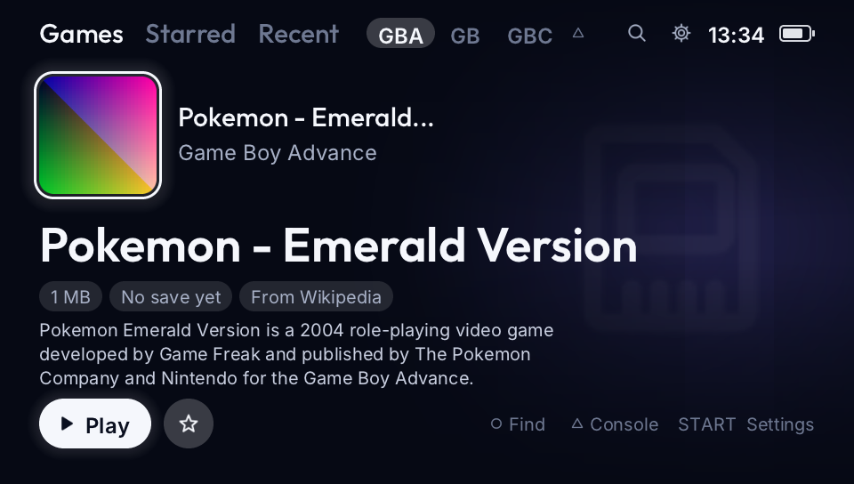
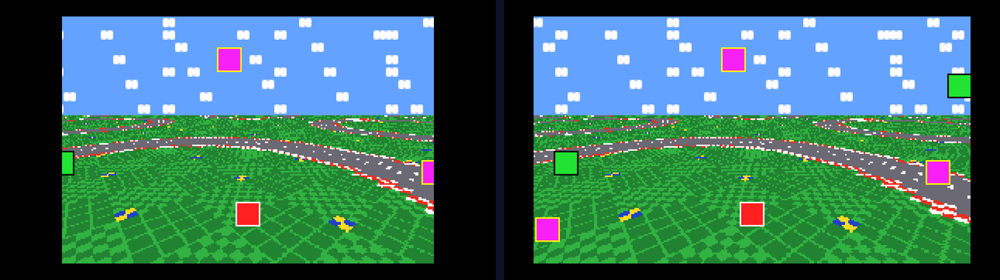
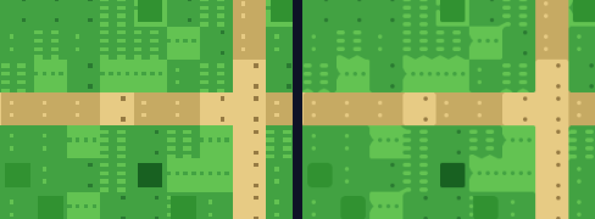
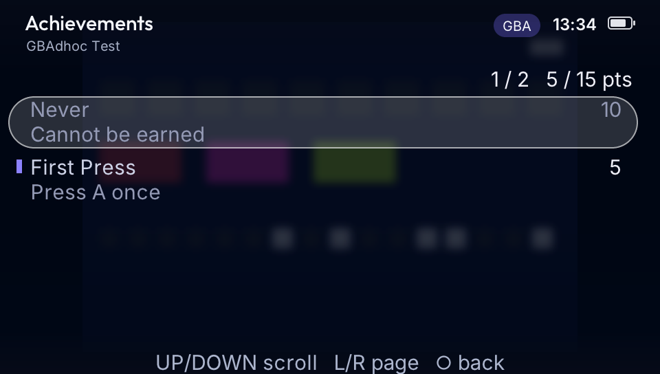
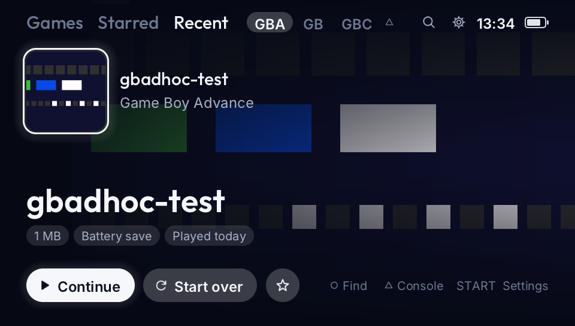
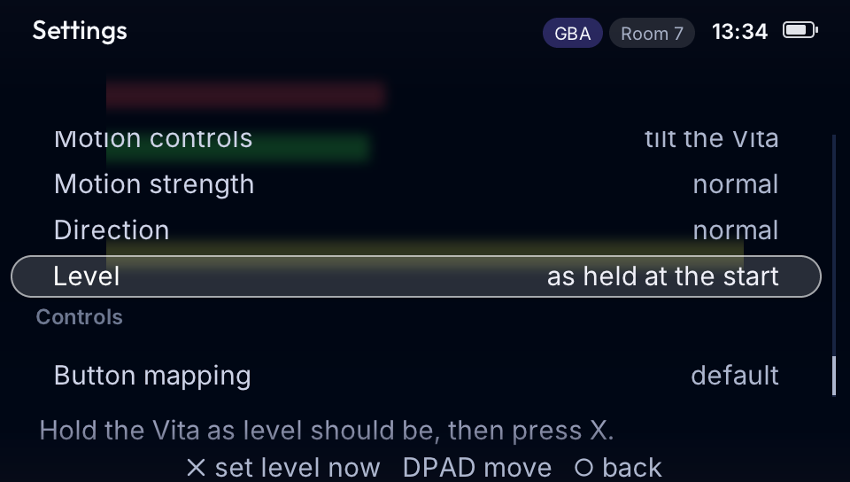
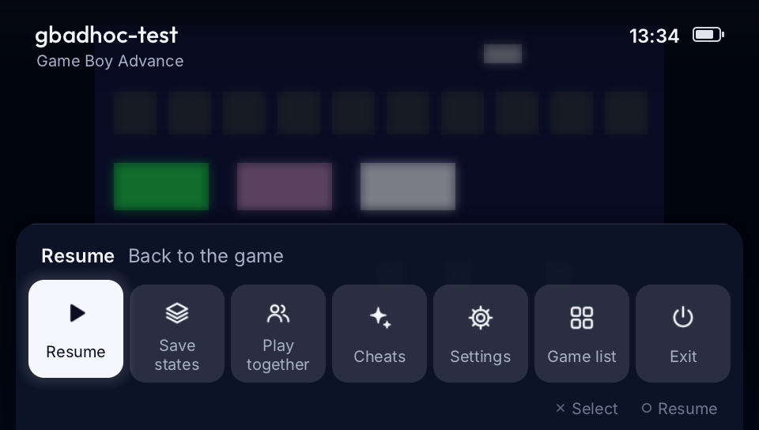
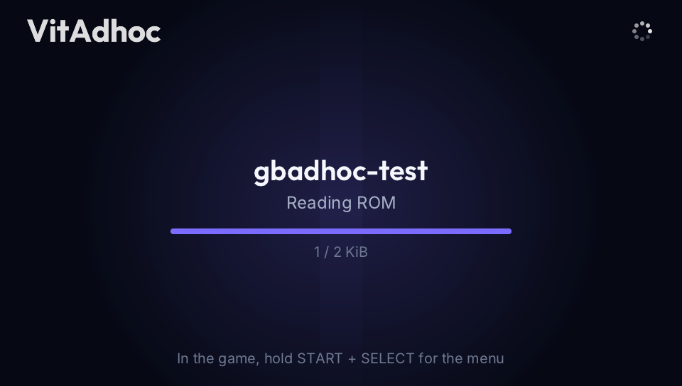

# VitAdhoc

### Game Boy Advance, Game Boy and Game Boy Color, reborn for the PS Vita.

Remember trading Pokémon with a friend over a link cable? Or that one cartridge
you played until the battery died? VitAdhoc brings all of it to the Vita, and
makes it better than you remember. Your whole library on a home screen that
fills itself with box art. A picture that is pin-sharp or beautifully smooth,
and wide enough to fill the Vita's screen. Full speed, rewind, and a Continue
button that drops you back into the exact moment you left. Link play with a
friend, achievements, tilt games and ROM hacks.

All of it native to the Vita: no PSP mode, no emulator inside an emulator.

**[Download VitAdhoc 1.2](https://github.com/CBOC-Vita-Lab/vitadhoc/releases/latest/download/VitAdhoc.vpk)**
· [Install guide](INSTALL.md) · [Controls](CONTROLS.md) · [What's in 1.2](CHANGELOG.md)

You'll need your own games. No BIOS download is needed: an open one is built in.

**Why VitAdhoc?** It keeps the heart of the PSP emulator [GBAdhoc](https://github.com/ShoshinFauteux/GBAdhoc) (its
emulator, link play and save formats) and rebuilds everything else as a real
Vita app: the Vita's own 960×544 screen instead of the PSP's 480×272 blown up,
all of the Vita's cores, touch and the motion sensor. Already a GBAdhoc
player? Your folder, games, saves and states carry straight over.

## New In Version 1.2

**Bring your saves, your folders and your zips.**

- **Your old saves come with you.** Coming from RetroArch? Start the game and
  your save is picked up by itself. From another emulator, drop the save in
  the `import` folder ([how](INSTALL.md#bringing-saves-from-another-emulator)).
  Nothing is moved, and a save VitAdhoc already has is never replaced.
- **Play your zipped games.** `.zip` files show up under the right console and
  play straight away.
- **Pick your game folders in Settings.** Type a folder to add it. No more
  editing files.
- **Start games from RetroFlow** and other launchers, straight into the game.
- **Ten save-state slots**, up from five.
- **Make it look like the real thing.** Put a bezel or shell picture over the
  game, and set the LCD grid from 1 to 10. Both are in Settings > Display.
- **Fewer hiccups and a lighter rewind** (see Performance below).

## Features

### A library that feels like a console's own
- **Home screen.** Your games as big tiles, with the game's own picture behind
  them. Tap, drag and flick, or use the buttons.
- **Box art by itself.** On Wi-Fi, covers and title screens download on their
  own, found by name, cartridge code or checksum, so renamed files still match.
  Your own pictures always win.
- **A few lines about every game.** About 1,300 GBA, GB and GBC games come with
  the opening of their Wikipedia article, built in, no network needed.
- **Previews of your own play.** Rest on a game and the last ten seconds you
  played start moving behind it.
- **Continue where you left off.** Leave a game, even by closing it from
  LiveArea, and one press puts you back in that exact moment. Plus a Recent
  tab and sorting by name, last played or most played.
- **Starred and Find.** Star favourites; Find matches words in any order and
  ignores accents and punctuation.
- **Uses the games you already have.** `ux0:ROMS/` and RetroFlow's folders are
  found without moving anything; add your own in Settings > Game folders.

### A picture made for the Vita's screen
- **Pixel-sharp or smooth.** Crisp, even pixels at any size, or xBRZ and
  Scale3x smoothing that redraws the pixel art with clean curves.
- **Wide view:** instead of black bars, more of the game. In Pokémon Emerald
  and its siblings (Ruby, Sapphire, FireRed, LeafGreen) the map really
  continues to the screen's edges.
- **Real handheld colours** (the muted look the art was drawn for), motion
  blend for games that flicker, LCD grid and scanline looks, five screen
  sizes, **Super Game Boy borders** and **screen overlays**.
- **A look for every game**, kept apart from the rest of your library.

### Play together
- **Trade and battle with a friend** in Link Cable and Wireless Adapter games,
  between two Vitas: on the same Wi-Fi, over the internet, or ad hoc with no
  router at all.
- **Game Boy and Game Boy Color links**, even between two different
  cartridges (Red with Blue).
- **Two players on one Vita**, side by side.
- **Share saves and states** between two Vitas, and receive real **Mystery
  Gift** cards from a phone.

### More to play
- **Rewind** the last 60 seconds, **fast forward**, ten **save-state slots**
  with pictures, **turbo buttons** and **screenshots**.
- **RetroAchievements**, with Hardcore mode.
- **Tilt, turn and sunlight games:** WarioWare: Twisted!, Yoshi Topsy-Turvy,
  Koro Koro Puzzle, Kirby Tilt 'n' Tumble and Boktai 1–3, using the Vita's own
  motion sensor.
- **ROM hacks and translations:** drop an IPS, BPS or UPS patch next to the
  game. Your original file is never changed.
- **Cheats** for about 2,190 games built in, plus your own codes.
- **No BIOS hunt:** an open GBA BIOS is built in (your own works too).

## Performance

**What you can expect:** the full 60 frames a second, like 1.0. Measured on a
real PS Vita:

| | |
| --- | --- |
| **Frame rate** | A steady 60 frames a second. Pokémon Ruby held 59.9 with xBRZ smoothing and the wide view both on. |
| **Headroom** | With xBRZ and the wide view on, a frame needs about 5 to 9 ms of its 16.7 ms. |
| **Input lag** | Each frame starts once the last one is on screen: up to a whole frame (17 ms) less between a press and the picture. |
| **Sound** | If the Vita falls behind for a moment, the game catches up without a gap in the sound. |
| **Overclock** | Optional 500 MHz profile for the PSVshell plugin: about a tenth less time per frame. |

**What's better than 1.0:**

| | Compared with 1.0 |
| --- | --- |
| **Rewind** | About half the work to record each step, and going back no longer makes the emulator rebuild the game's code. |
| **Smoothing** | xBRZ and Scale3x find what changed with fewer memory reads. |
| **Menus and covers** | Removing a picture no longer makes the whole app wait for the graphics chip. |
| **Sound** | No more gaps or clicks when a frame runs long (since 1.1). |

These speed-ups were checked in the app's computer test build and haven't
been timed on a Vita yet. On our first play-test on a Vita, with every feature
on, it felt noticeably smoother.

## Bug Fixes Since 1.0

- **A graphics error no longer freezes the picture.** It used to stay frozen
  for the rest of the session; now the app recovers and carries on.
- **Cleaner smoothing.** xBRZ and Scale3x no longer draw over a picture that
  is still on screen, and running short of graphics memory no longer shows a
  black picture.
- **Cleaner sound** (1.1): no gaps or clicks, Game Boy-style sounds on the
  correct side, no pop when you open, pause or resume a game, and no leftover
  sound after loading a state.
- **Names with accents read properly:** "Pokémon" shows as "Pokemon", not
  "Pok??mon".
- **Your settings are safe:** if they can't be saved (say, a full memory
  card), the previous ones are kept.

[Known Issues](KNOWN-ISSUES.md) lists what is still being confirmed on a Vita,
and the [technical notes](docs/TECHNICAL.md) have the full engineering list
for every version.

## Screenshots

| Continue | Achievements |
| --- | --- |
|  |  |
| **Recent** | **Motion games** |
|  |  |
| **The in-game menu** | **Save states** |
|  |  |
| **Two players on one Vita** | **Display settings** |
|  |  |
| **Starting a game** | |
|  | |

Screens from the app's computer test build, with the project's own test
cartridges.

## Install

**What you need:** a PS Vita with HENkaku or Ensō, VitaShell, and your own
`.gba`, `.gb` or `.gbc` games.

**Easy way: CBOC Vita Installer.** Open the
[CBOC Vita Installer](https://github.com/CBOC-Vita-Lab/vita-installer/releases)
on your computer, give it this page's link (or the VPK) and add your games if
you like. It finds the Vita and does the rest. See [Desktop Install](DESKTOP-INSTALL.md).

**Manual way:**

1. Copy `VitAdhoc.vpk` to your Vita (VitaShell, over USB or FTP) and install it.
2. Start VitAdhoc once. It creates `ux0:data/GBAdhoc/`.
3. Put your games in `ux0:data/GBAdhoc/roms/`, or leave them in `ux0:ROMS/`
   or your RetroFlow folders: those are found automatically.
4. Start it again and pick a game.

**Updating?** Just install the new VPK over the old one. Your games, saves,
states and settings stay where they are.

## Playing

| Button | Does |
| --- | --- |
| Cross / Circle | A / B |
| Hold Start + Select, or tap the screen | Open the menu: save states, link play, cheats, settings |
| Square | Fast forward |
| Right stick left, or Select + Square | Rewind |
| Select + L / Select + R | Quick save / quick load |
| Triangle (home screen) | Switch between GBA, GB and GBC |
| Select (home screen) | All games, Starred, Recent |

Press Start on the home screen for Settings. Every button can be changed in
Settings > Controls. [Controls](CONTROLS.md) has the full list and
[Play Together](PLAY-TOGETHER.md) the two-player setup.

## Download Contents

| File | What it is |
| --- | --- |
| `VitAdhoc.vpk` | The app. Install it on your Vita. |
| `VitAdhoc-install.zip` | The VPK plus the guides, checksums and complete source. |

## For Developers

| | |
| --- | --- |
| [Building](docs/BUILDING.md) | Build the VPK and run the tests |
| [Technical notes](docs/TECHNICAL.md) | How it works, switches, and each version's engineering changes |
| [Source record](docs/SOURCE.md) | What this release was built from |
| [Licensing](LICENSING.md) · [Assets](docs/ASSETS.md) · [Notices](notices/THIRD-PARTY.md) | Licences and third-party components |
| [Check a download](docs/CHECK-DOWNLOAD.md) | Verify files against `SHA256SUMS` |

The app is in `gpsp/vita/`; the emulator cores and shared frontend are in
`gpsp/`.

## Credits

Built by AI agents (Claude), directed and play-tested by a human. VitAdhoc
stands on [GBAdhoc by ShoshinFauteux](https://github.com/ShoshinFauteux/GBAdhoc),
gpSP by Exophase and the libretro contributors, TGB Dual,
[rcheevos](https://github.com/RetroAchievements/rcheevos) and the other
projects in [Credits](CREDITS.md).

An unofficial fan project, not affiliated with Nintendo, Sony or
RetroAchievements.
