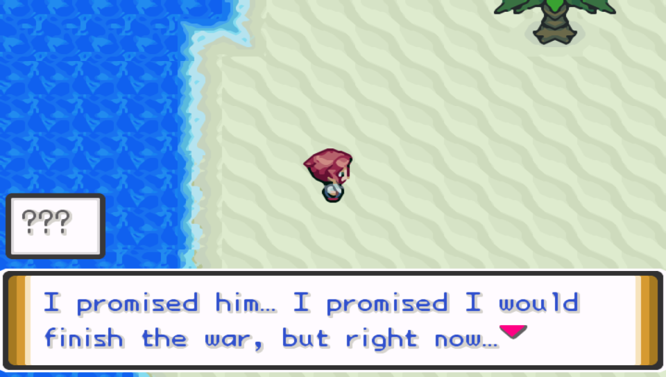

# Performance

## 2.0 NEON xBR and MMPX in the two players (qemu and model numbers; nothing here ran on a Vita)

The Super NES and Sega players scale with playerkit's pk_scale (xBR 2x / 3x and MMPX 2x, 16 bit, on the drawing thread and its helpers).
The decisions of xBR were already eight pixels wide (compiler vectors); the new NEON loops (playerkit/src/pk_scale.cpp, ARM builds only) also do the
luminance plane, the output colour of every pixel (12 bit blends, the choice of the nearer result, the 565 rounding) and the stores eight pixels at
a time, and MMPX's rules for eight pixels at once (the same rules as the main app's mmpx_vita.c, written for 565 output). The C loops stay as the
reference and for every other CPU. The picture is byte for byte the C loops' (and xBR's the integer reference's): playerkit/tests/scale_neon_check.cpp
runs both on 11 kinds of generated picture (noise, four colours, flat, flat with specks, gradients, steps, pixel art of three densities with blocks,
diagonals and dither, near-equal colours, tile maps) at 17 sizes (160x144, 240x160, 256x224, 320x224, 256x192 and odd small ones down to 1x1), whole,
in three stripes (the helper threads' split) and as partial dirty-region calls, on a wider pitch too, and requires identical bytes, an identical busy
count and untouched pixels outside a rectangle (`make -C playerkit arm-check`, gate step `playerkit-scale-arm`; 0 mismatches). The arithmetic that
replaces a table (luminance, 565 to 12 bit, the rounding back, the blend) is checked against the tables for every value when the scaler starts; a
difference would switch NEON off. The main app's own MMPX NEON loop (the first table of this file) is unchanged; its xBRZ is a different, third-party
algorithm and is not touched.

Guest instructions per frame under qemu-arm 8.2 (label **qemu**: ARM instructions, NEON ones counted one each, so NOT time and NOT a Vita
measurement; a NEON instruction on the Vita's Cortex-A9 costs more than one cycle), 256x224, C loop (before) -> NEON loop (after). "Typical" is a
pixel-art test picture with about 12 % non-flat pixels, "busy" one with 18 % busy xBR pixels and 48 % non-flat MMPX pixels (400 blocks, lines and
dither; harder than a game frame):

| Scaler | Typical C -> NEON | Busy C -> NEON |
| --- | --- | --- |
| MMPX 2x | 2.59 M -> 2.20 M (1.2x fewer) | 7.48 M -> 5.21 M (1.4x) |
| xBR 2x | 5.46 M -> 2.48 M (2.2x) | 14.36 M -> 7.15 M (2.0x) |
| xBR 3x | 7.11 M -> 3.26 M (2.2x) | 19.91 M -> 10.19 M (2.0x) |

(The "before" is the tree's C loop, which the compiler already vectorises on ARM; against the float xBR of the first design note the gain is larger.)
Model, 444 MHz at IPC 0.7 to 1.0 (2.25 to 3.2 ms per million): xBR 2x of a 256x224 typical picture about 5.6 to 8 ms of one core now against about 12 to 17 ms,
before the helpers share it. Smaller than the 3x the design hoped for: the four rotations' decisions are about a third of the NEON loop and the blends
about a third; the next steps would be to share the absolute differences between rotations and to prune the ramp tests per sub pixel (the dead lanes of a
sub pixel are already skipped). MMPX gains little because playerkit's C loop already had the eight wide flat test.
Not changed: the look governor. The ceilings (pic_scaler_ceiling) are set by the picture's size against the 544 row screen, not by a cost table, and
the player's ladder rungs carry fixed costs; they should be retuned from the console's own `up_us` once a Vita has timed these loops (build with
`-DPK_SCALE_NO_NEON` or `scale_use_neon(false)` to compare).
Compiled with the VitaSDK's arm-vita-eabi-g++ 15.2 with the Makefile's flags (`make -C playerkit vita`): no warning, and the object holds the intended
NEON (vabd, vqrdmulh, vmull / vrshrn, vst2 / vst3).

## 2.0 performance pass: MMPX, the NES wide view, the wide-view boot frame (host, qemu and model numbers; nothing here ran on a Vita)

Nothing in this pass lowers a picture: every change is bit-identical to what it replaces, and the tests below prove it.
Labels: **host** = x86_64 callgrind (instructions), **qemu** = armhf guest instructions counted under qemu-arm, **model** = a
conversion to milliseconds (444 MHz, IPC 0.7 to 1.0), **estimate** = a judgement. The pictures of the MMPX measurements are
six frames of a private test set resampled to 240 x 160 (noisier than a true 1:1 frame, so they have more edges than a real
game picture and are close to a worst case for the scaler).

| Change | Proof of identity | Cost before / after | Vita (model) |
| --- | --- | --- | --- |
| MMPX 2x in NEON (gpsp/vita/mmpx_vita.c): eight pixels at a time, all the rules as compares and selects, luma computed from the 565 value, a whole group of eight flat pixels is one lookup and eight vector stores | upscale_test: NEON loop equals the C loop on 44 pictures (noise, flat with specks, lines, all colours; 11 sizes; cut at odd columns) under qemu, plus the existing MMPX stripe / slide / ring tests; the same output hash as the C loop on all six real frames | qemu, guest instructions per 240 x 160 frame, C -> NEON: 9.19 M -> 3.99 M, 3.61 M -> 1.33 M, 5.62 M -> 2.50 M (2.3x to 2.7x fewer; NEON instructions are not all one cycle, so the time gain is smaller) | about 1.5x to 2x faster MMPX (estimate); runs on the draw helper threads, not the game thread |
| NES wide view adapter (nes/frontend/wide.c): the margin fill runs as three runs (map seam, raw margin, learned map) with the palette pass hoisted out of the pixel loop; the fixed-line "one colour" test checks a tile's row once when its two bit planes are 00 or FF | wide_golden.sh: all 37 composed-picture hash files equal the committed baseline (wide_golden_sha256.txt), before and after | host, scrolling cartridge, 300 frames with the view on: compose 304.6 M -> 192.3 M; wide view's extra cost (view on minus off, twin hashing left out) 3.50 M -> 2.97 M per frame (-15 %) | about 1.2 to 1.7 ms less per frame on the compose thread (model, 444 MHz, IPC 1.0 / 0.7) |
| WonderSwan portrait rotation (wswan/frontend/layout.c): 8 x 8 blocks, a transpose in registers on ARM | rotate_test (blocked equals one-pixel-at-a-time, x86 and armhf under qemu), wswan-selftest orientation property test | the strided write of the pixel loop touched a new cache line per pixel; counted only as correct, not timed | small (32 K pixels a frame), estimate under 0.3 ms |

What the copy audit found. The per-frame picture path is: core draws into its buffer, the hand-over copies it into a slot (needed:
the core overwrites its buffer while the draw thread works), the upscaler copies it into its own "current" buffer while comparing it
with the picture before (one pass; the old picture has to be kept anyway), then the upscaled picture is uploaded. For a 240 x 160
GBA picture each copy is 77 KB, well under 0.1 ms; the Super Game Boy border copies only when the border changes and the game's 160
rows each frame; the NES palette pass and the WonderSwan mix (already NEON) are single passes. No copy was found that a change could
remove without a risk to the hand-over's timing, so none was removed: they are listed here so nobody looks for them again. What was
found and fixed is a loop, not a copy: the WonderSwan rotation above.

Not done, plainly: the NES wide view does not cache the nametable ring analysis (describe) between frames. Its output depends on the
frame counter while a cell is "settling" (a few frames after a write), so a cache would need a per-cell settle test, for about 3 % of
the view's cost; the learned map, the margin recorder in the core (nesp_tiles, on the emulation thread, 7 % of a wide-view frame)
and widekit's own passes (base_fill, edge colours) are other people's code in this pass and were left alone. The NEON MMPX loop is not
timed on a Vita; the first run on one should compare the `up_us` of the log with the C loop (build with -DMMPX_NO_NEON).

The GBA boot picture: a boot that starts on scanline 126 (the Polarium Advance fix, as mGBA does) has no whole first frame, so the
render thread's check no longer compares that one partial picture (it was the only frame the check ever failed on, once per start,
in the render_thread test).

## Super NES On VitAdhoc 2.0 (host and model numbers, nothing here ran on a Vita)

Counted on an x86_64 host with callgrind over the emulator's own code (Minstr per emulated frame, frames 1500 to 1560 of the owner's pad
script) and turned into milliseconds by a model: x86 instructions counted as ARM instructions, 444 MHz, IPC 1.0 and 0.7. They are
estimates; the 1.3 table below is the only measured Vita data in this file. "Counted frame" is a frame on which the wide view counts its
coverage and composes both margins whole (every second frame); on the frames between, a side that shows the ambient frame is not composed.

| Game | Core, wide view off | Wide, margin 41: all / compose (average, counted frame) | Wide, full width (margin 96): all / compose (average, counted frame) |
| --- | ---: | --- | --- |
| Yoshi's Island | 7.6 | 11.2 / 2.5, 3.0 | 12.5 / 3.3, 4.2 |
| Super Mario World | 6.6 | 10.8 / 2.8, 3.3 | 12.3 / 3.3, 4.0 |
| Super Mario Kart | 5.0 | 9.0 / 2.7, 2.9 | 10.4 / 3.2, 3.5 |
| Super Metroid | 7.0 | 9.5 / 0.9, 0.9 | 11.4 / 1.2, 1.2 |
| Kirby Superstar | 6.2 | 10.0 / 2.9, 3.6 | 10.9 / 3.3, 4.2 |
| ChronoTrigger | 4.8 | not measured | 10.9 / 4.4, 5.0 |
| Donkey Kong 1 - Country | 6.0 | not measured | 10.9 / 2.6, 2.9 |
| Doom | 13.8 | not measured | 17.4 / 2.8, 3.1 |
| F-Zero | 5.9 | not measured | 10.5 / 2.4, 2.5 |
| Mega Man X 2 | 4.8 | not measured | 9.2 / 3.1, 3.5 |
| Pilotwings | 6.8 | not measured | 10.9 / 1.4, 1.6 |
| Street Fighter Alpha 2 | 5.2 | not measured | 8.7 / 2.3, 2.5 |
| Stunt Race FX | 7.3 | not measured | 10.4 / 2.1, 2.4 |
| Super Mario RPG | 6.8 | not measured | 9.8 / 1.3, 1.5 |
| Zelda - A Link to the Past | 5.7 | not measured | 12.4 / 4.2, 4.2 |

(The full width before the second step of this pass cost 18.3 / 8.0 in Yoshi's Island, 19.2 / 8.0 in Super Mario World, 14.3 / 5.9 in Super Mario
Kart, 12.6 / 2.4 in Super Metroid and 16.2 / 7.7 in Kirby Super Star. "All" includes the margin thread's passes and the capture. Doom's 13.8 is the
Super FX chip emulation, which the player throttles; it is the same with the wide view off.)

Per thread and per core at the full width, counted frame, tree of 20 Nov 2026 (model, ms per frame at IPC 1.0 / 0.7; a 60 Hz frame is 16.7 ms on
one core and 50.1 ms on the three cores of a console without the fourth). The game thread is the CPU, the DMA and the chip; the picture thread
the renderer without margin passes; the margin thread the margin passes and the capture; compose is the whole compose of a counted frame, alone
(the lines can be shared with the scaler's helpers); "three cores" adds 3 ms of scaler, 1.5 ms of upload and 0.7 ms of audio and divides nothing:
it is the sum of all the work against 3 x 16.7 ms, the best packing there could be, and the percentage is of 50.1 ms:

| Game | Game thread | Picture thread | Margin thread | Sound thread | Compose, counted frame | All, three cores | of 50.1 ms |
| --- | --- | --- | --- | --- | --- | --- | --- |
| Yoshi's Island | 7.7 / 10.9 | 5.0 / 7.1 | 3.5 / 5.0 | 4.5 / 6.5 | 9.4 / 13.5 | 35.3 / 48.3 | 71 / 96 |
| Super Mario World | 4.3 / 6.2 | 5.2 / 7.4 | 5.3 / 7.6 | 5.4 / 7.7 | 9.1 / 12.9 | 34.5 / 47.0 | 69 / 94 |
| Super Mario Kart | 3.2 / 4.6 | 3.4 / 4.8 | 4.9 / 6.9 | 4.7 / 6.7 | 7.9 / 11.3 | 29.2 / 39.5 | 58 / 79 |
| Super Metroid | 3.0 / 4.3 | 8.3 / 11.8 | 7.2 / 10.3 | 4.4 / 6.3 | 2.7 / 3.8 | 30.8 / 41.8 | 61 / 83 |
| Kirby Superstar | 6.9 / 9.8 | 2.4 / 3.5 | 3.1 / 4.4 | 4.8 / 6.8 | 9.4 / 13.5 | 31.8 / 43.2 | 63 / 86 |
| ChronoTrigger | 3.5 / 5.0 | 3.6 / 5.1 | 3.7 / 5.2 | 3.7 / 5.3 | 11.3 / 16.1 | 30.9 / 42.0 | 62 / 84 |
| Donkey Kong 1 - Country | 3.5 / 5.1 | 5.7 / 8.1 | 5.0 / 7.2 | 4.4 / 6.3 | 6.5 / 9.3 | 30.4 / 41.1 | 61 / 82 |
| Doom | 19.5 / 27.8 | 6.6 / 9.5 | 1.6 / 2.3 | 5.0 / 7.1 | 6.9 / 9.9 | 44.9 / 61.9 | 90 / 123 |
| F-Zero | 3.0 / 4.2 | 5.5 / 7.8 | 5.0 / 7.1 | 4.8 / 6.8 | 5.7 / 8.1 | 29.1 / 39.3 | 58 / 79 |
| Mega Man X 2 | 3.2 / 4.5 | 2.8 / 4.0 | 2.9 / 4.2 | 4.8 / 6.9 | 7.9 / 11.2 | 26.8 / 36.0 | 53 / 72 |
| Pilotwings | 3.7 / 5.3 | 7.3 / 10.4 | 6.3 / 9.0 | 4.3 / 6.1 | 3.5 / 5.0 | 30.3 / 41.1 | 61 / 82 |
| Street Fighter Alpha 2 | 3.4 / 4.8 | 3.6 / 5.1 | 2.8 / 4.0 | 4.8 / 6.8 | 5.6 / 8.0 | 25.4 / 34.0 | 51 / 68 |
| Stunt Race FX | 8.3 / 11.8 | 2.3 / 3.3 | 2.3 / 3.2 | 5.7 / 8.2 | 5.5 / 7.9 | 29.3 / 39.7 | 59 / 79 |
| Super Mario RPG | 5.2 / 7.4 | 5.4 / 7.8 | 3.7 / 5.2 | 4.8 / 6.8 | 3.3 / 4.7 | 27.6 / 37.1 | 55 / 74 |
| Zelda - A Link to the Past | 3.1 / 4.4 | 5.0 / 7.1 | 5.5 / 7.9 | 4.8 / 6.8 | 9.5 / 13.5 | 33.1 / 45.0 | 66 / 90 |

What the model says, plainly. **Per thread** every game fits a 60 Hz frame at the full width at IPC 1.0 and at 0.7 except Doom, whose game thread
(the Super FX chip) is 27.8 ms at IPC 0.7 with the wide view off as well, and Stunt Race FX (game thread 11.8) and Super Metroid (picture thread 11.8) are the
next heaviest; the compose of a counted frame alone is under 16.7 ms everywhere (Chrono Trigger 16.1 is the largest at IPC 0.7), but with the scaler's
3 ms and the upload's 1.5 ms the drawing thread needs a helper for Chrono Trigger, Yoshi's Island, Super Mario World, Kirby Super Star and
Zelda at IPC 0.7. **Per core, on three cores,** the best possible packing of a counted frame is 71 % of 50.1 ms at IPC 1.0 (Yoshi's Island) and
94 to 96 % at IPC 0.7 for Super Mario World and Yoshi's Island (90 % Zelda, 86 % Kirby, 84 % Chrono Trigger, 83 % Super Metroid, 82 % or less for the
others; Doom 123 %: its chip alone). A real scheduler does not pack that well, so by the model the full width on three cores is held at IPC 1.0
and is on the edge at IPC 0.7 for Super Mario World and Yoshi's Island; where it is not held the player measures it and Auto narrows the margin, as
before ("On" keeps the full width and may drop frames). With the fourth core (66.8 ms) there is room everywhere except Doom. Nothing here ran on a
Vita: the two IPC values are the two ends of the model, and the 7 November console calibration agrees with 0.7.

Where the threads run (snes.bin, `playerkit/src/pk_cores.cpp`): the scaler's helpers, which also take lines of the compose, were planned on core 1, the
core of the drawing thread that composes and of the PPU thread, so they could not run beside it. They are now on core 0 (in the gaps below the
emulating thread) and core 2 (below the sound chip thread), with and without the fourth core; the margin thread (cores 0 and 2, above the helpers)
and the helpers share those two cores' gaps. The log line `wide_lines ... by_helpers=` shows how many lines the helpers really took.

An option, `stagger` (off), would count the two sides' coverage on alternate frames and so make the dearest frame of a scene with two ambient
sides as cheap as the average (Yoshi's Island and Super Mario World by the model: 13.5 to 10.6 and 12.9 to 10.7 ms of compose, 2 to 3 ms of the
three cores). It changes the margins' cross-fade timing; the difference table is in snes/WIDE-INTEGRATION.md, "Margin thread". It stays off: the
differences are not small everywhere (Street Fighter Alpha 2 differs on 9.7 % of the frames, up to 239 of 255 in one channel), and the model does
not show the extra 2 to 3 ms to be needed.

The rewind capture: 823 KB per state before 2.0, about 300 KB (plain cartridge), 430 KB (Super FX) or 570 KB (SA-1) now (1.16 M -> 0.53 M host
instructions in Super Mario World), estimated 0.5 to 1.2 ms on the Vita. It is now written after the frame's picture and sound have been handed
on, in the time the game thread would wait for the next refresh, and put off (at most 8 refreshes) on a pass that is already late: it is off the
frame's path, the copy itself is not smaller.

## Super NES On VitAdhoc 1.3

Measured on a PS Vita (firmware 3.74, PSVshell profile at
500 MHz; the core measured 494-496 MHz) on 7 November 2026, with the
release's SNES player and its default picture (Fit, ambient glow).
Each game was started through VitAdhoc and left running its title screen,
attract mode or demo with no input for 100-120 seconds; the first four
seconds (start-up) are left out. "Game thread" is the time the emulated CPU
(plus the cartridge's extra chip, where there is one) needs per frame; the
picture and the sound run on two other cores and are not the limit in any of
these games.

| Game (owner's cartridge dump) | Chip | Emulated frames/s | Game thread per frame (average / worst second) | Shown |
| --- | --- | ---: | --- | --- |
| Super Mario World (PAL) | none | 50.0 of 50 | 5.5 / 7.5 ms | every frame |
| Donkey Kong Country | none | 59.7 of 60 | 4.7 / 14.9 ms | every frame |
| F-Zero | none | 59.9 of 60 | 5.1 / 5.8 ms | every frame |
| Chrono Trigger | none | 59.9 of 60 | 4.6 / 10.2 ms | every frame |
| Yoshi's Island | Super FX 2 | 59.7 of 60 | 8.2 / 13.5 ms | every frame |
| Super Mario RPG | SA-1 | 59.1 of 60 | 11.5 / 16.8 ms | every frame |
| Kirby Super Star | SA-1 | 59.1 of 60 | 11.0 / 15.3 ms | every frame |
| Stunt Race FX (PAL) | Super FX | 49.4 of 50 (46.5 before pacing) | 10.0 / 21.9 ms | every frame |
| Doom | Super FX 2 | 59.0 of 60 (40.7 before pacing) | 13.4 / 23.0 ms | every frame |

The display runs at 59.9-60 Hz in every game; "every frame" means no frame
was dropped to save time. Super Mario World and Stunt Race FX are European
(50 Hz) dumps, so 50 is their full speed.

What changed for these numbers, all with the same output as before (frames
and sound compared bit for bit on 289 test programs and the 15 games, with
and without the extra threads):

- **One emulated frame per screen refresh.** The first hardware run showed
  games running at twice their speed: a pass that handed its picture over
  without waiting started the next frame early. Passes now follow the
  display's own refresh count.
- **Battery RAM written on its own thread.** Super FX games such as Yoshi's
  Island change their battery RAM all the time, and writing it on the game
  thread every two seconds cost a third of a second each time (a stutter
  every two seconds, about 52 frames a second on average). It is now copied
  and written by a low-priority thread, when it settles or every 30 seconds.
- **SA-1 idle loops replayed.** Super Mario RPG and Kirby Super Star spend
  about 80% of their SA-1 instructions waiting in a loop. Such a loop is
  recorded once, proven to repeat exactly, and then advanced without
  interpreting it while nothing it reads changes (`snes/core/sa1cpu.cpp`).
  Their game thread went from 16.5 and 14.9 ms to 11.5 and 11.0 ms a frame.
- **WAI waits skipped to the next event** when no SA-1 is present.
- **The console stays awake** while a SNES game runs (it used to turn the
  screen off, and stop the game, during demos with no buttons pressed).

- **Super FX pacing.** Doom keeps the GSU busy all the time; at the
  hardware's instruction rate a frame needed 22-27 ms on the game thread
  (GSU 15-18 ms), so everything ran at two thirds of its speed, music
  included. The SNES player now times the GSU (`superfx clock` lines in its
  log) and sets its instructions per line to the share that fits a refresh
  (90% of it, adjusted every second; never below 30%, back to 100% when there
  is room). Game, music and controls keep full speed; the 3D view gets fewer
  GSU instructions per emulated frame than on a SNES and so animates more
  slowly. Doom settles near 35%, Stunt Race FX between 42% and 77% in races;
  Yoshi's Island stays at 100%. This changes the emulated GSU's speed, not
  its results; the twin and the bit-for-bit comparisons run it at 100%.

- **Faster Super FX interpreter (block cache, `gsu_fast`, on by default).**
  `snes/core/fxfast.cpp` decodes the chip's instructions once into blocks (the
  prefix instructions folded into the instruction they belong to, the source
  and destination registers resolved, the fetch and cache-line cost of the
  block added up in advance) and runs them with computed-goto dispatch; the
  slice's last few instructions, code in RAM and anything unusual go to the
  old interpreter. A second pass (20-21 Nov) made it faster still: a block
  remembers the two blocks it went on to last, so most block ends need no hash
  lookup and the pipe byte is only stored when control leaves; flags that no
  later instruction of the block reads are not written (dead-flag elimination,
  with variants of the arithmetic instructions); the branch ops account for the
  delay slot's fetch themselves; the plot and read-pixel code exists once per
  colour depth; the per-slice set-up of the cache-line flags is eight lines at a
  time. The result is the same to the bit: pictures, sound, saved
  state and the chip's cycle count match the old interpreter on Doom, Stunt
  Race FX and Yoshi's Island (3,600 frames each at 100, 73, 50 and 35 % clock),
  on the 58 homebrew GSU test ROMs (at 100 and 40 %), on x86 and on armhf under
  qemu, under ThreadSanitizer with the picture and sound threads, and in a
  build that runs every slice with both and compares the whole chip state (the
  three games at 100, 60 and 35 % clock and the homebrew ROMs at 100 and 30 %,
  3.7 million slices, no difference; one homebrew ROM that injects code into
  the chip's cache RAM never enters the fast path). Measured, **host x86**
  (callgrind, instructions inside the chip's run function, 1,560 frames from
  the title to the game): Doom 2.74 G (reference interpreter) -> 1.42 G (first
  block cache) -> **1.00 G** (55.8 -> 28.9 -> 20.5 per GSU instruction), Stunt
  Race FX 1.57 G -> 0.86 G -> **0.60 G** (53.0 -> 28.9 -> 20.4); 2.7 times
  fewer than the reference, 1.4 times fewer than the first block cache.
  Measured, **armhf under qemu** (dynamic ARM instructions per frame inside the
  chip's run function, three frames from a saved state; the Vita build flags,
  not a Vita), five places in three games: Doom (frame 1500) 5.2 M (reference)
  -> 2.49 M (first block cache) -> **1.75 M**, Doom (frame 1100) 7.9 -> 3.26 ->
  **2.26 M**, Stunt Race FX (frames 2000 and 3000) 5.5 -> 3.73 -> **2.44 M** and
  2.9 -> 1.92 -> **1.20 M**, Yoshi's Island 1.8 -> 0.73 -> **0.46 M** (the
  reference figures are the whole frame minus the rest of the emulator, so
  they are the least exact). The whole emulator in the first Doom place:
  13.4 M (reference), 10.7 M (first block cache), **10.0 M** instructions a
  frame. **Model, Vita** (the calibration above, the chip's part of the game
  thread scaled by the armhf ratios; nothing ran on a Vita): Doom's game thread
  at the chip's full speed was 19.5 / 27.8 ms (IPC 1.0 / 0.7) with the
  reference interpreter and about 12.5 / 18 ms with the first block cache;
  with this one it is about **10 / 14 ms** (9 / 13 ms from the second Doom
  place), under a 16.7 ms frame at both ends of the model, with the chip at
  full speed. The pacing above should then settle at 100 % in the model instead
  of 35 %, i.e. the 3D view should animate at the speed of a SNES. This rests
  on the instruction counts being a fair stand-in for time on a Cortex-A9 (the
  block cache has more data dependent branches and a larger working set than
  the reference interpreter, which the count does not show) and on the split
  between the chip and the rest of the game thread in the old calibration:
  treat it as likely, not as measured. The wall-clock gain on the host is
  smaller than the instruction count (the rest of the frame is the picture and
  the sound), and qemu's own wall time hides most of it. What is left in the
  chip's time: plotting (on armhf about 60 instructions a pixel, about 40 % of
  the chip's time in Doom: four 16-bit read-modify-writes per 8-bit pixel),
  about 30 instructions a block for entering it, and the instructions at the end
  of each line's budget that still go through the old interpreter (about 3 % at
  100 % clock). Tried and dropped: gathering the pixels of a tile row in a
  register and writing them back together, as the chip's own pixel cache does
  (cost more instructions on armhf in all five places, because Doom and Stunt
  Race FX mostly plot a different tile row every pixel and the bookkeeping
  outweighed the saved writes; not compared on x86). Not done: running a
  slice's last instructions as part of a block instead of through the old
  interpreter, and merging blocks into longer ones across unconditional
  branches.

A faster interpreter still than this one, or the GSU on a core of its own, is what would give these
games the last of their 3D frame rate.

## Pokemon Unbound 2.1.1.1 On VitAdhoc 1.2

**About 60 emulated fps in the sampled opening beach scene, at full-screen
stretch with CPU xBRZ 3x.** The frontend produced about 44 video callbacks
per second across three repeat samples. Settings, exact results and counter
definitions are below.

### Test Setup

| Item | Setting or result |
| --- | --- |
| Date | 2026-11-03 |
| Hardware | One physical PS Vita |
| Executable | Existing installed 1.2 runtime, read back and hash-matched before testing |
| Game | User-supplied Pokemon Unbound 2.1.1.1, 32 MiB; private ROM, not distributed |
| Output | 960 x 544, full-screen stretch |
| Smoothing | CPU xBRZ, Enhanced 3x; every selected upscaler window reports factor 3 |
| Other display options | Wide view off, colour correction off, motion blend off; ambient setting 2 |
| Gameplay options | Keep full speed on; 60-second rewind and gameplay previews enabled |
| Fast-forward | Off during all selected measurement intervals |
| Clock | Unchanged by this test. Platform API reported 444 MHz; the startup timing probe estimated 496 MHz, using a different measurement method. |
| Capture | Installed VitaCompanion 1.10 display-plane capture, outside measurement intervals |
| Scope | Animated water and dialogue in the opening beach scene, with no player input |

The core selected its built-in GBA BIOS for Unbound. The test used the
existing app and clock settings.

### Three Repeat Samples

These are three consecutive sampling blocks from one session.
Each block contains two complete 600-loop performance windows. A 15-second
settling exclusion follows the starting snapshot. There were no controller
commands, captures or FTP requests during the controlled interval.

| Sample | Duration | Emulated frames/s | Frontend-produced frames/s | Frontend sampling coverage |
| --- | ---: | ---: | ---: | ---: |
| 1 | 25.659 s | 59.940 | 44.106 | 20.020 s |
| 2 | 27.494 s | 59.285 | 44.906 | 10.199 s |
| 3 | 26.426 s | 59.940 | 44.758 | 20.019 s |

The three blocks span 79.579 seconds and average **59.714 emulated fps**.
Seven whole frontend sampling intervals contained in that overall span
average **44.316 callbacks/s** across 70.382 seconds; some cross a block
boundary and therefore do not appear in an individual row's coverage.

The original three-by-three-window plan needed nine qualifying windows;
only eight were captured. The repeat blocks therefore use the first six,
in order, with two windows each. Including **all eight** eligible windows
gives 104.771 seconds at **59.768 emulated fps**, and 45.141 frontend
callbacks/s over 90.429 seconds of independent frontend samples.

The audio counter recorded **six additional underruns** over the selected
six windows, and seven over all eight. Across the broader starting/ending
snapshots, including settling and partially excluded boundaries, it rose
from 23 to 35. No audio-port errors were recorded in the selected windows.

### What The Counters Mean

- **Emulated fps:** handheld frames advanced per elapsed second. Keep full
  speed can run catch-up frames without drawing all of them.
- **Frontend-produced frames:** non-null core video callbacks before the
  display sink. Calculated from `(win - skipped) / dt_us`.
- **Upscaler factor:** the actual CPU smoothing factor reported by the
  runtime.
- **Audio underruns:** cumulative runtime counters, differenced across the
  selected windows.
- **Physical display fps:** unmeasured in this run; a high-speed camera or
  display-presentation instrumentation would measure it separately.

The `q` diagnostic values count queue conditions and waits.

### Reproduce The Test

Use the 1.2 executable, the same game revision and the
settings above. Advance to the pictured opening beach dialogue. Release
fast-forward, settle, then collect complete `vita_win`, `vita_upscale`,
`vita_audio` and `fps` intervals without capturing or transferring files.

Rates are computed as total frame counts divided by total elapsed time.
Vita-window durations use consecutive
log-emission timestamps, so small logging-overhead differences remain.
Frontend windows use their explicit `dt_us` and are not aligned to the
600-loop windows. Only wholly contained frontend intervals are included.

Exploratory setup also showed scene-dependent slowdown: one early interval
logged 55.022 emulated fps and 28.978 frontend callbacks/s. Although no
fast-forward, menu or suspend event overlaps that interval, capture/FTP
interference is unknown for this exploratory interval.

For lighter display processing, choose Original pixels or a lower image
quality setting.

### Inspectable Metrics And Captures

- [Structured metrics and selection rules](performance/unbound-2.1.1.1-metrics.json)
- [Vita performance windows](performance/unbound-vita-windows.csv)
- [Independent frontend windows](performance/unbound-frontend-windows.csv)
- [Three sampling blocks](performance/unbound-batches.csv)
- [Capture provenance and screenshots](../store/screenshots/vita-1.2/README.md)

The public exports contain fixed-schema numeric metrics. Raw device logs,
account information, network addresses, ROMs, BIOS files and saves are
excluded. The test copy used a unique filename, keeping existing saves separate.
The original game's battery save and resume files were read back unchanged.
Settings and play history were restored; the FPS counter was left off as
requested.

## Earlier Evidence

| Version | Game | Recorded result | Settings |
| --- | --- | --- | --- |
| 1.0 | Pokemon Ruby | About 60 emulated fps | CPU xBRZ and wide view enabled |

Version 1.2 changes reduce repeated work in rewind, smoothing and texture
handling. [Source Record](SOURCE.md) lists the automated test results,
reruns and remaining hardware checks.

## Sega (Genesis, Master System, Game Gear) On VitAdhoc 2.0

Nothing here has run on a Vita. Labels: host = x86_64 callgrind instruction counts, model = those counts at 444 MHz and an assumed IPC.

Instructions per frame, host x86_64 callgrind (120 frames, worker off, scaler not included):

| Game | Frame | VDP line renderer | Sound | Z80 | 68000 |
|---|---|---|---|---|---|
| xgm-player (SGDK sample, H40) | 4.20 M | 2.21 M | 0.41 M | 0.64 M | 0.90 M |
| bad-apple (SGDK sample) | 3.49 M | 1.46 M | 0.83 M | 0.22 M | 0.93 M |
| busy SMS homebrew | 1.07 M | 0.50 M | 0.24 M | 0.31 M | none |
| Game Gear (an SMS ROM forced to Game Gear, a stand-in) | 0.92 M | 0.34 M | 0.24 M | 0.31 M | none |

Model, per thread, margin to 16.7 ms (NTSC; PAL has 20 ms, so 3.3 ms more):

| Game | Single thread, IPC 1.0 / 0.7 | Emulating thread with the VDP worker, IPC 1.0 / 0.7 | VDP worker, IPC 1.0 / 0.7 |
|---|---|---|---|
| xgm-player | 9.5 ms (7.2) / 13.5 ms (3.2) | 4.5 (12.2) / 6.4 (10.3) | 5.0 (11.7) / 7.1 (9.6) |
| bad-apple | 7.9 (8.8) / 11.2 (5.5) | 4.6 (12.1) / 6.5 (10.2) | 3.3 (13.4) / 4.7 (12.0) |
| busy SMS | 2.4 (14.3) / 3.4 (13.3) | 1.3 (15.4) / 1.8 (14.9) | 1.1 (15.6) / 1.6 (15.1) |
| Game Gear (stand-in) | 2.1 (14.6) / 2.9 (13.8) | 1.3 (15.4) / 1.8 (14.9) | 0.8 (15.9) / 1.1 (15.6) |

The numbers leave out the picture scaler, the upload and the audio thread (all on other threads or in the drawing thread). x86 and ARM
instruction counts differ (ARM is usually 1.1 to 1.4 times more); with that factor the single thread xgm-player at IPC 0.7 is over 16.7 ms,
which is what the worker is for.

Measured on the host twin: the VDP worker is bit-identical to the single thread (hashes of picture, sound, state and RAM, 96 ROMs, x86 and
armhf under qemu). Worker busy time, host x86_64 wall clock, an SMS homebrew: about 41 microseconds a frame, joins about 23 microseconds a frame.

### Sega: the FM chip on its own core (2.0)

Nothing here has run on a Vita. host = x86_64 callgrind instructions per frame of the emulating thread inside `md_host_run_frame` (240 frames of
the twin, the twin's picture hashing not counted, `--separate-threads`, profile build); model = those instructions at 444 MHz, IPC 1.0 (2.26 ms per
million) / IPC 0.7 (3.21 ms per million), no ARM factor. The YM2612's synthesis (`YM2612Update`) moves to a worker behind a write log
(`core/fm_thread.c`); the emulating thread keeps the status register's timer flags (a small copy of the chip's timers), the BUSY flag, the FM clock
and the mix into the blip buffer. The PSG stays where it is (it is about 0.1 M a frame and writes the same blip buffer the mixer owns).

| Game | Single thread | Emulating thread, VDP worker (the default before) | Emulating thread, VDP + FM workers | FM worker |
|---|---|---|---|---|
| xgm-player | 4.69 M, 10.6 / 15.1 ms | 2.54 M, 5.7 / 8.2 ms | 1.88 M, 4.3 / 6.0 ms | 0.69 M, 1.6 / 2.2 ms |
| bad-apple | 3.61 M, 8.2 / 11.6 ms | 2.53 M, 5.7 / 8.1 ms | 1.94 M, 4.4 / 6.2 ms | 0.58 M, 1.3 / 1.9 ms |
| sonic (DAC drums, about 700 chip writes a frame) | 3.89 M, 8.8 / 12.5 ms | 2.73 M, 6.2 / 8.8 ms | 2.05 M, 4.6 / 6.6 ms | 0.76 M, 1.7 / 2.4 ms |

What the emulating thread still pays for the chip: the write log and the timer copy, about 19 thousand instructions a frame (0.02 M), and
the join at the end of the frame (200 thousand over 240 frames). The wait for the worker is not in these numbers: callgrind runs the threads one
after the other, so the wait cannot be measured there. On the twin (wall clock, two pthreads, a busy shared PC) the join waited about 13 microseconds a
frame on average (xgm-player, sonic 11) and the worker was busy 45 ms of 600 frames of xgm-player (a lightly loaded moment; the PC was shared). On the Vita the worker is placed on core 2
beside the sound thread (0x60, below the sound thread's 0x40). The wait is bounded (5 ms); then the emulating thread finishes the queue itself.

Bit identical: picture, sound, state and RAM hashes of the 30 SGDK samples with the worker, with the timer copy checked against the chip at
every join, with a join after every run of samples, with the queue always finished by the emulating thread, with a 24 word queue and with the VDP worker
as well; the saved state is the same bytes; a state saved by one path loads in the other; Quick response; chip types; PAL; a reset; the Sega CD
stand-in playing FM with PCM and CD audio (`md/twin/fm_check.sh`, gate step `md-fm`). Nuked chip options run inline.

### Quick response in the app: Game Boy, Game Boy Color, NES, WonderSwan, and why not Game Boy Advance (2.0)

Nothing here has run on a Vita. host = x86_64 callgrind instructions per frame inside `fe_host_run_frame` (the real frame, the state copy, the look-ahead
frame and the way back; the picture work of the twin is not in it; 30-frame windows from frame 150; `gpsp/vita/hostcore/ahead_cost.sh`); model = those
instructions at 444 MHz, IPC 1.0 (2.26 ms per million) / IPC 0.7 (3.21 ms per million), no ARM factor, as in the Sega section below.

| Game (test cartridges) | Plain: host, model | Run-ahead: host, model | Ratio host |
|---|---|---|---|
| Game Boy cpu_instrs | 1.66 M, 3.7 / 5.3 ms | 2.83 M, 6.4 / 9.1 ms | 1.71 |
| Game Boy Color acid2 (a still picture: the CPU idles) | 0.82 M, 1.9 / 2.6 ms | 1.00 M, 2.3 / 3.2 ms | 1.21 |
| NES nes15, wide view Auto | 5.17 M, 11.7 / 16.6 ms | 8.67 M, 19.6 / 27.8 ms | 1.68 |
| NES nes15, wide view Off | 2.99 M, 6.8 / 9.6 ms | 5.86 M, 13.2 / 18.8 ms | 1.96 |
| WonderSwan WSHWTest | 3.04 M, 6.9 / 9.8 ms | 3.75 M, 8.5 / 12.0 ms | 1.23 |
| WonderSwan spritepriority | 5.93 M, 13.4 / 19.0 ms | 8.90 M, 20.1 / 28.6 ms | 1.50 |
| Game Boy Advance, three attract screens of private games (probe) | 1.29 to 1.41 M, 2.9 to 3.2 / 4.1 to 4.5 ms | 2.87 to 2.98 M, 6.5 to 6.7 / 9.2 to 9.6 ms | 2.07 to 2.23 |

A run-ahead frame costs between 1.2 and 2 times a plain one: the real frame is not drawn and the look-ahead frame makes no sound, so it is less than two
frames. The plan's rule (half a frame, 8.3 ms) is met by the Game Boy and the lighter WonderSwan cartridge at IPC 1.0 and missed by the NES and the
busier WonderSwan one, which is why the setting is Auto: the governor (`pk_ahead.h`) starts it only when the projected cost is at most half a frame
and stops it when frames run late, so a game that does not fit runs plain (the Game Boy and the lighter games gain it, a heavy NES game with the wide view
does not). The numbers are a model, not a measurement on the console. qemu (armhf twin under qemu-arm) cannot resolve the ratio here: its time is the
twin's picture work, 125 to 130 ms a frame, and run-ahead added 0.3 to 5 ms to it (Game Boy 5.0 ms, NES 1.8 ms, WonderSwan below the noise).

State sizes: Game Boy about 59 KB plus the carry block (64 bytes), NES about 23 KB plus up to 18 KB of carry (the sound filter history and buffer), WonderSwan about 71 KB; at these sizes a copy is a few
hundredths of a millisecond (estimate, not measured on the console).

Game Boy Advance is not offered. The probe (`GBADHOC_AHEAD_GBA_PROBE=1`, twin only: each frame also saves, runs a second frame and loads) shows 2.1 to 2.2 times
a plain frame on attract screens, where a play scene costs more; the state is 416 KB and loading it throws away the translated code (the whole cache
unless the load keeps the ROM's, as the wide view's scout does; the host numbers above do not show the cost of translating it again on the console, which is
the reason to expect worse), and the heaviest games already use most of the Vita's frame. The machine-identical proof was not run for it. The setting is
hidden for Game Boy Advance games, and the plan's rule says no.

### Sega: Quick response (run-ahead) and the sprite pass of frames nobody sees (2.0)

Nothing here has run on a Vita. host = x86_64 callgrind instructions per frame inside `md_host_run_frame` / `md_host_run_frame_ahead` (120 frames, the
twin's own picture hashing not counted); model = those instructions at 444 MHz, IPC 1.0 (2.26 ms per million) / IPC 0.7 (3.21 ms per million), no
ARM factor; qemu = user time of the armhf twin under qemu-arm on the same PC (it includes the twin's hashing, so only the ratio means anything).

| Game | Plain: host, model | Run-ahead: host, model | Ratio host / qemu |
|---|---|---|---|
| SMS busy homebrew (single thread) | 1.94 M, 4.4 / 6.2 ms | 3.81 M, 8.6 / 12.2 ms | 1.96 / 1.94 |
| Game Gear test cartridge (single thread) | 1.04 M, 2.3 / 3.3 ms | 2.12 M, 4.8 / 6.8 ms | 2.04 / 1.76 |
| heaviest of the 73 8 bit test ROMs (estimate: plain measured 2.23 M, ratio 1.96) | 2.23 M, 5.0 / 7.2 ms | about 4.4 M, 9.9 / 14.0 ms | |
| Mega Drive xgm-player, single thread | 4.21 M, 9.5 / 13.5 ms | 7.69 M, 17.4 / 24.7 ms | 1.83 / 1.74 |
| Mega Drive xgm-player, emulating thread with the VDP worker | 2.38 M, 5.4 / 7.6 ms | 5.47 M, 12.4 / 17.6 ms | 2.30 / |
| Mega Drive bad-apple, single thread | 3.50 M, 7.9 / 11.2 ms | 6.27 M, 14.2 / 20.1 ms | 1.79 / 1.97 |
| Mega Drive bad-apple, emulating thread with the worker | 2.47 M, 5.6 / 7.9 ms | 5.62 M, 12.7 / 18.0 ms | 2.27 / |

Run-ahead costs about twice a plain frame (the real frame without drawing, the saved state, the drawn look-ahead frame, the way back). The 8.3 ms
rule of the plan (half a frame) is met by the Game Gear cartridge (4.8 ms at IPC 1.0) and missed by the busy SMS ROM (8.6 ms), the heaviest 8 bit ROMs
(9.9 ms) and every heavy Mega Drive sample, so the Mega Drive default is Off. The 8 bit default is Auto even though the rule is not met on the heaviest ROMs: the governor (`pk_ahead.h`) starts it only when the
projected cost is at most half a frame and stops it when frames run late, so a game that does not fit runs plain. The default was set from
these model numbers and the proofs, not from a measurement on the console; it is one number (`player.cpp`, `quick_response`) to change.

The state copies are small on the 8 bit consoles (state 83 KB) and 145 KB on the Mega Drive; the load no longer marks all of VRAM as changed
(the tile cache keeps its dirty flags with the state and the worker and the wide view hear only about blocks that really differ), so the way back
costs no more than the copy.

The sprite pass of frames that are not drawn (fast forward, half-rate pacing, the real frame behind a run-ahead picture; host, `--no-render`,
instructions per frame spent in `render_line`, which is the sprite parse and the sprite drawing into the line buffer, with no background and no
pixels out): xgm-player 0.82 M (19 % of a plain frame; 1.9 / 2.6 ms model), bad-apple 0.08 M (2 %; 0.18 / 0.25 ms), busy SMS 0.04 M (2 %;
0.10 / 0.14 ms). Before 2.0 such frames drew nothing, and games whose status register told them about a sprite collision ran differently
(15 of 67 test games). A Mega Drive scene with many sprites is the one place where this costs real time.

## Super NES: Mode 7 pixel loop and the wide view's strip cache (22 Nov 2026; host numbers, nothing here ran on a Vita)

Two changes with identical output: Mode 7 pixels with colour math are drawn in vector chunks (`snes/core/tileimpl.h`), and a margin line whose inputs
did not change since the last frame is not drawn again (`snes/core/gfx.cpp`). Proof: pictures, sound, state hashes (every 50 frames) and whole wide picture
hashes identical to the build before, over all 15 test games, 3000 frames each, 14 runs per game (margins 96 and 41, the cost ladder's floor, worker
threads, each switch off); the strip cache also checked line by line against a fresh draw (0 differing), with random register, VRAM, colour memory and
OAM writes (also between lines of a frame, `$2100` / `$2106` / `$2133`, OAM priority rotation), a VRAM write counter forced across 2^32, state loads, resets, margin changes and the margin thread leaving and joining; armhf under qemu (NEON) equal to x86 byte for byte on eight games. Details and the exact commands: `snes/WIDE-INTEGRATION.md`.

| Scene | Before (host, M instr / frame) | After (host, M instr / frame) | Change |
|---|---|---|---|
| Super Metroid, Mode 7 scene, margin 0 | 6.99 | 6.03 | -13.8 % |
| Super Metroid, margin 96 | 11.38 | 9.98 | -12.2 % |
| F-Zero, margin 96 | 10.50 | 8.56 | -18.4 % |
| Pilotwings, margin 96 | 10.96 | 9.93 | -9.4 % |
| Yoshi's Island, wide (margin 96) | 11.34 | 10.56 | -6.9 % |
| Mega Man X 2 / Street Fighter Alpha 2 / Super Mario Kart, margin 96 | 9.22 / 8.76 / 10.37 | 9.28 / 8.82 / 10.45 | +0.7 / +0.7 / +0.8 % |

Host x86_64 callgrind, instructions of the whole twin frame, frames 1500 to 1560 of the owner's pad script, one run per game. The Mode 7 draw functions
alone went down by about 39 % on Super Metroid. The Vita time of these changes is not measured and not estimated here; instruction counts on x86 SSE2
do not translate directly to NEON. Merging margin batches of many lines was not done (cannot be exact in a streaming renderer); the scrolling
games pay about 0.7 % for hashing lines that never hit.

## Super NES: Quick response (run-ahead) (25 Nov 2026; host numbers and a model, nothing here ran on a Vita)

A refresh run ahead is the real frame (not drawn), a light save of the machine in memory (`snes/core/ahead.cpp`), the next frame (drawn,
silent) and the way back. Snes9x's own state save and load were not used: on the PC build they cost 0.09 to 0.28 ms and 0.23 to 2.1 ms
(the load resets the machine, waits for the picture thread and gives it the whole video memory again), the light save and way back 0.02
to 0.12 ms together (host wall time, a shared 2-core machine; the numbers vary by a factor of two between runs). Emulating thread, host
x86_64, CPU ms per refresh over 1200 frames:

| ROM | plain | run ahead | ratio |
| --- | ---: | ---: | ---: |
| WaveHDMA (PeterLemon) | 0.43 | 0.66 | 1.5 |
| FFVIIPrelude (SPC700 music) | 0.28 | 0.62 | 2.2 |
| Mode 7 StarWars | 0.46 | 0.79 | 1.7 |
| GSU 8BPP FillPoly (Super FX) | 0.58 | 1.12 | 1.9 |
| SA-1 work cartridge | 1.13 | 2.21 | 2.0 |
| StarWars / GSU / SA-1, APU and picture threads on | 0.21 / 0.42 / 0.87 | 0.41 / 0.76 / 1.88 | 2.0 / 1.8 / 2.2 |

Instructions (callgrind, x86_64, 300 frames all run ahead): the save and the way back are 0.30 M instructions a refresh for StarWars, 0.38 M
for the Super FX program and 0.68 M for the SA-1 cartridge (its 260 KB of BW-RAM and the SA-1's own memory map), against 4.5, 7.0 and 13 M for
one frame of emulation. Model (x86 instructions as ARM instructions, 444 MHz, IPC 1.0 / 0.7): 0.7 / 1.0 ms, 0.9 / 1.2 ms and 1.5 / 2.2 ms a
refresh on a Vita, an estimate only (the copies are memory bound: the save and the way back compare in chunks of 256 bytes and write only
what changed, which keeps the writes to what one frame changed). With the game thread of the 15 owner games at 3.0 to 8.3 ms a frame (IPC 1.0,
table above) and 4.2 to 11.8 ms (IPC 0.7), Auto's rule (2.3 x plain + 0.6 ms at most half of 16.7 ms) lets it start only where a plain
frame is about 3.4 ms or less: Super Metroid, F-Zero, Zelda, Mega Man X2 and Super Mario Kart at IPC 1.0, none at IPC 0.7. Elsewhere Auto does
not start and the game runs as without it; On forces it and drops frames there. The console log's `ahead:` line (`plain_ms`, `ahead_ms`,
`save_ms`, `back_ms`) gives the real numbers.
