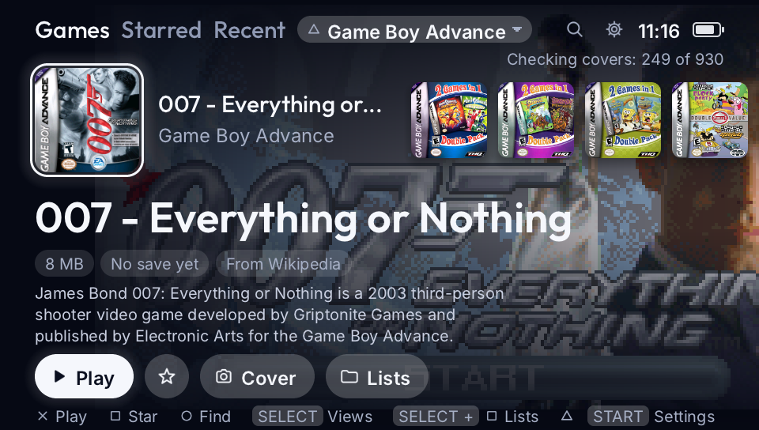
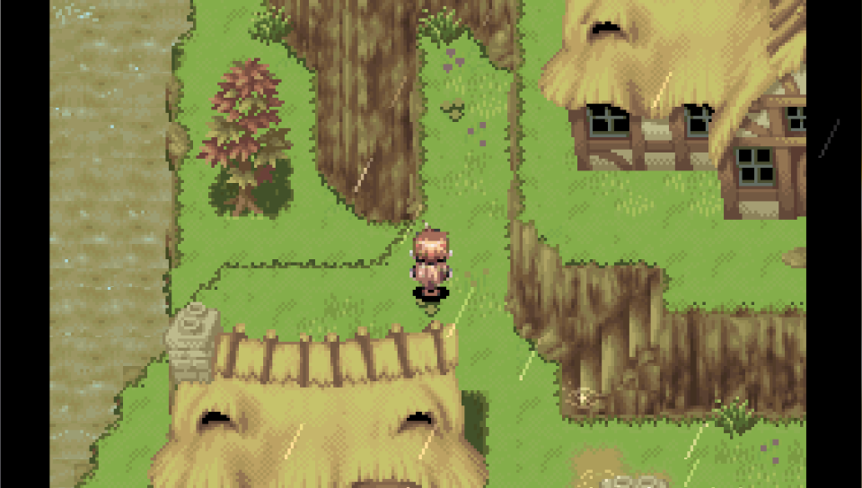
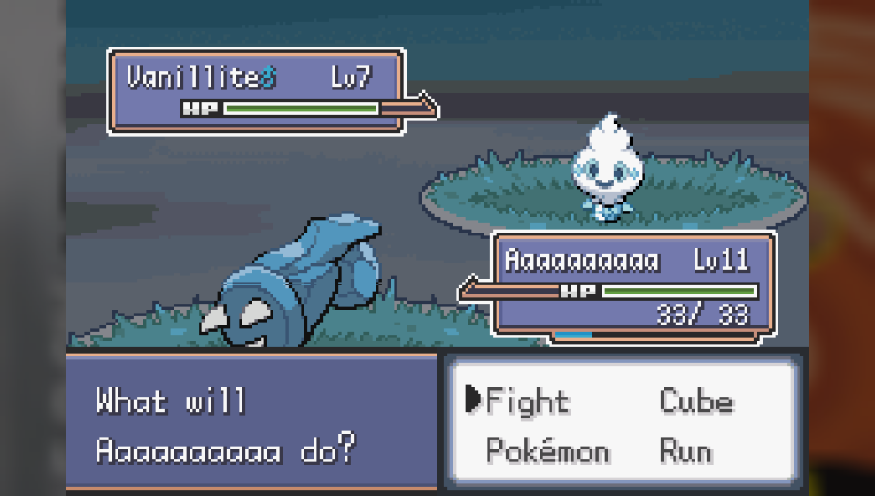
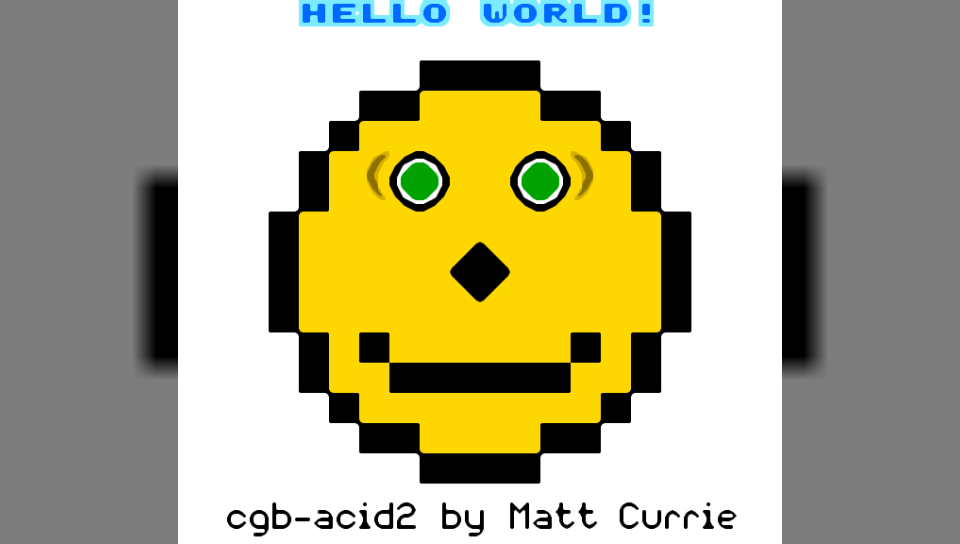

# VitAdhoc 2.0: 11 Consoles, 60 fps Wide View, and Online Play by Room Code

**VitAdhoc 2.0** brings **11 retro consoles** into one native PS Vita app: Game Boy Advance, Game Boy, Game Boy Color, NES / Famicom, WonderSwan / Color, Super NES, Genesis / Mega Drive, Sega CD / Mega CD, Master System, Game Gear, and SG-1000.

Everything runs from one home screen with automatic box art, Wikipedia descriptions, gameplay previews, Continue, ten save-state slots, RetroAchievements, and a 7,005-game built-in cheat database. Pick a game and play at locked 60 fps with zero-stretch 16:9 Wide View, or link up with a friend anywhere using a 5-character room code (`vitadhoc.psvita.dev`) with no port forwarding and no accounts.

---

## Real PS Vita Screenshots (`960x544`)

*2.0 home screen on a physical PS Vita: box art grid, hero art, Wikipedia summary, Triangle console picker (`Game Boy Advance`), and live `Checking covers: 249 of 930` progress.*

| GBA Wide View (Locked 60 fps) | GBA ROM Hack at Locked 60 fps | GBC Default 4x xBRZ Supersampling |
| :---: | :---: | :---: |
|  |  |  |
| *Golden Sun* filling 16:9 with zero pixel stretching | *Pokemon Unbound* Battle: **34.08 → 60.0 fps** | `cgb-acid2` (Gambatte Accurate): `640×576 → 604×544` Fit |

---

## What's New Since v1.3.1

Version 2.0 combines all work from the unreleased 1.4 wave and the full 2.0 cycle, expanding VitAdhoc from 4 consoles to 11.

### 11 Consoles in One Native Vita App

- **7 new consoles added since v1.3.1:**
  - **NES & Famicom** (FCEUmm): `.nes`, `.fds` (Famicom Disk System with your own `disksys.rom`), `.unf`, `.unif`, plus touch-screen **NES Zapper** support.
  - **WonderSwan & WonderSwan Color** (Beetle WonderSwan): `.ws`, `.wsc`, `.pc2`. Automatic portrait/landscape rotation, upright or sideways Vita controls, 75 Hz-to-60 Hz motion blending, and unswapped physical buttons (`Circle = A`, `Cross = B`) across all Vita regions.
  - **Sega Genesis / Mega Drive, Master System, Game Gear, and SG-1000** (Genesis Plus GX in `md.bin`): `.md`, `.gen`, `.smd`, `.68k`, SEGA-header `.bin`, `.sms`, `.gg`, `.sg`, `.sc`. Default 6-button Genesis layout (`Square`/`Cross`/`Circle` = A/B/C, `L`/`Triangle`/`R` = X/Y/Z), dedicated-core YM2612 FM audio, and optional **No sprite flicker** on 8-bit Sega.
  - **Sega CD / Mega CD** (in `md.bin` with a disc read-ahead thread): `.cue`+`.bin`, `.iso`, `.chd` (LZMA/zlib/zstd/FLAC), and `.m3u` multi-disc playlists with in-game tray swap (**Settings > Speed > Change disc**). Requires your own region Sega CD BIOS; per-game backup RAM and configurable RAM cartridge (512 KB default).
- **Upgraded cores for existing consoles:**
  - **Game Boy / Game Boy Color:** TGB Dual (Standard, default for link, Camera, and SGB borders) alongside an optional cycle-accurate **Gambatte** core (`Settings > Game Boy core > Accurate`) sharing battery saves, palettes, cheats, rewind, Quick Response, and RetroAchievements.
  - **Game Boy Advance** (gpSP ARMv7 dynarec with upgraded generic SMC cache) and **Super NES** (Snes9x 1.63 + post-1.63 fixes and a faster exact Super FX block cache).
- **Drop-down Console Picker:** Press **Triangle** on the home screen to jump directly to any of the 11 consoles with live game counts.

### Online Multiplayer by 5-Character Room Code

- **Play together anywhere (`vitadhoc.psvita.dev`):** Host any supported game, share the 5-character code (omitting `I`, `L`, `O`, `0`, and `1` so characters never look alike), and your friend joins from any Wi-Fi network or hotspot. No port forwarding, no accounts, and no PSN sign-in. Direct UDP NAT hole-punching runs first (with STUN fallback) and switches automatically to a Cloudflare TURN relay when routers block direct links. Optional **Always use the relay** hides your IP from peers.
- **Full two-player coverage:**
  - **GBA Link Cable & Wireless Adapter:** Online, Same Wi-Fi, or Nearby (Ad-Hoc). Link Cable supports cross-version trading and battling (Ruby + Sapphire, FireRed + LeafGreen, Emerald + FireRed) with cached cartridge transfer and an in-app cartridge picker when joining.
  - **GB / GBC Link Cable:** Cross-generation `.gb` + `.gbc` links (such as Gen 1 + Gen 2 Time Capsule) over Online, Same Wi-Fi, Nearby, or same-console split screen.
  - **Two Players (NES, WonderSwan, SNES, Genesis / Mega Drive, Sega CD single-disc, Master System, SG-1000):** Shared two-Vita play over Same Wi-Fi or Online (plus Nearby on NES and WonderSwan).
- **Same-Console 2P Split Screen, Mystery Gift & Save/State Sharing:** Two GBA or GB/GBC instances side by side on one Vita/PS TV (second DualShock or touch-screen P2 pad), built-in GBA Mystery Gift Station receiver, and Vita-to-Vita save/state sharing over Wi-Fi or Online room codes.
- **Hardened state loading & disconnect recovery:** Every core validates incoming state data (fuzz-tested under host sanitizers), and unexpected partner disconnects preserve host gameplay progress.

### True 16:9 Wide View & Best-Looking Visual Defaults

- **Zero-stretch Wide View out of the box:**
  - **GBA Wide View** defaults to `On + any game` with **Soft edges** (toggle per game if a title's edges misbehave).
  - **Full-height `956×544` NTSC NES Wide View:** Fills all 544 vertical pixels at Fit (`394×224` NTSC / `422×240` PAL) with zero top/bottom letterbox bars, backed by live nametables, learned level maps, soft edge falloff, and 2x upscaling (`xBRZ 2x`, `MMPX 2x`, `Scale2x`) or Sharp Bilinear.
  - **SNES & Sega Wide View (Auto by default):** Keeps the native image pixel-exact in the center while extending left and right margins with real background/learned data or soft edges, never guessed tiles.
- **Governed `Image quality: Auto` (best picture without dropping frames):**
  - **GB / GBC:** Defaults to **4x xBRZ supersampling** (`640×576` scaled cleanly down to `604×544` at Fit).
  - **GBA & WonderSwan:** Starts at xBRZ 3x, stepping through xBRZ 2x, MMPX 2x, and Sharp Bilinear (software-3D GBA bitmap titles automatically start at Sharp Bilinear).
  - **SNES & Sega:** NEON-accelerated xBR 2x/3x and MMPX 2x (with automatic 3x-to-2x step-down within the `1024×576` texture budget on 8-bit Sega).
  - Manual selections stay locked; the per-frame Look Governor only adjusts **Auto** mode.
- **Unified looks & colour profiles across all 11 systems:**
  - Independent 0–10 sliders for **Ambient glow**, **Scanlines**, **LCD grid**, **CRT mask** (aperture-grille stripes), and **LCD ghosting**.
  - Authentic console colour profiles (GBA, GBC, WonderSwan, Game Gear LCD, NES NTSC), **GBC Auto** palettes for original Game Boy cartridges (detected by cartridge header, not extension), an optional **Screen: OLED (PCH-1000)** colour profile folded directly into the LUT at zero extra cost, and **Smooth 50 Hz** mode for PAL NES, SNES, and Sega games (plus **Steady pacing** and **Smooth hand-over**).

### Gameplay, Library, Accessibility & Extras

- **Quick Response (1-frame run-ahead):** Cuts input lag by 1 frame on GB, GBC, NES, WonderSwan, SNES, and Sega (Auto where headroom allows; off during link/online and not used on GBA).
- **Rewind & Fast Forward:** Right-stick left for Rewind and right-stick right for Fast Forward on by default across all 11 systems (`Select + Square` also rewinds). Fast Forward adds **normal-pitch audio** alongside 2x, 3x, Unlimited, and Unlimited Smooth.
- **RetroAchievements on all 11 consoles:** Hardcore mode, live progress counters (`3/10`), near-unlock markers, leaderboard trackers, and an in-game **Achievements** viewer in `snes.bin` and `md.bin`.
- **7,005-Game Cheat Database + Live Memory Search:** Bundled `cheats.db` holds **7,005 games (151,936 cheats)**, paired with on-console **Search memory** (Exact, Changed, Unchanged, Increased, Decreased, including GBC banked WRAM) on every system. Unified shortcuts: `Triangle` = Add, `Square` = Delete.
- **Save Safety & 10 State Slots Everywhere:** Automatic backups before overwriting external saves, two-way **RetroArch save sync** + on-demand **Export save**, ten thumbnail state slots per game with **Slot Lock (`L`)** and persisted **Undo (`R`)** across all 11 consoles.
- **Library Organization & `.7z` Archives:** Custom **Collections**, **Most played** / **Not played yet** views, read-only **RetroArch & Emu4Vita++ `.lpl` playlists** (JSON and legacy 6-line), full **`.7z`** support everywhere `.zip` works, **Game title vs File name** display toggle, and Wikipedia descriptions for NES, WonderSwan, and Sega (~460 mismatched descriptions cleaned out of older consoles).
- **Extras & Accessibility:** **Save Clip** (10-second lossless animated PNG), **Game Boy Camera** (Vita front/back camera or `camera.png`) & **Game Boy Printer** (PNG export to `prints/`), mappable **Rear Touch Panel** (unified 12% grip inset + center deadzone), **Left stick** (`D-pad` / `Custom` / `Off`), **Button Test**, **Tap screen for menu** toggle, synced **Light / Dark theme**, **Large text** & **High contrast** (`display.ini`), **8 UI languages** (English, Spanish, French, German, Italian, Brazilian Portuguese, Japanese, Simplified Chinese) with CJK/Korean/Greek/Cyrillic text rendering everywhere, and a daily opt-out GitHub **Update check**.

---

## Real PS Vita Hardware Performance

Measured on a physical PS Vita (500 MHz via PSVshell, 4-core Auto; runs at 444 MHz stock without PSVshell):

| Scenario / Game | Before (`2.0 rc6`) | After (`2.0`) | What Changed |
| --- | --- | --- | --- |
| **Cold boot (`cheats.db` init)** | 4,880 ms | **0.016 ms** | Lazy `cheats.db` & `rom_crc` loading |
| **Cold boot → interactive Home Screen** | 5,000+ ms | **55.8 ms** (23 ms 1st frame) | Deferred scan + lazy DB (2,886 ROMs across 11 systems scanned in **2.74 s**) |
| **Menu landing on a new game** | Visible hang (25 `stat`s/game) | **0 UI waits / 0 GPU blocks** (1 `stat`, 1.0 ms max upload) | Lock-free loader pools, CDRAM texture reuse, 1 GPU upload/frame cap, D-pad tap latching |
| **Checking covers (live Vita Wi-Fi)** | Slow serial TLS/HTTP | **249 / 930 checked in ~10 s** | HTTP/1.1 Keep-Alive, O(1) index, batched misses, box-art-first two-pass fetch, SD yield |
| **NES launch (1,091-ROM folder, *SMB 3*)** | >40 s freeze | **3.6 s cold / 0.88 s warm (45x faster)** | Cached `sidecar_migrate`, `art_dir_cache`, skip blocking `.vh565` write |
| **GBA launch (925-ROM folder, *Golden Sun*)** | ~18.4 s | **2.87 s** | Same FAT32 launch-path fixes |
| **GBA SMC ROM hack (*Pokemon Unbound* Battle)** | 34.08 fps (`jit=10.69 ms`, 531 reclaims) | **Locked 60.0 fps** (`jit=0.051 ms`, **0 reclaims**, `vm_syncs` -99.7%) | Generic `SMCR_MAXVER=256` MTF LRU + `src_hash` + 1.5 MiB carve (100% bit-exact) |
| **GBA (*Pokemon Unbound* Town, *Golden Sun*, *Mario Golf*)** | 48.21 fps (Town) | **Locked 60.0 fps** (`miss=0%`) | Generic SMC cache + GBA ARMv7 dynarec & NEON PPU optimizations |
| **SNES SA-1 (*Super Mario RPG*, Wide View)** | 28.8 fps (half-pace lock) | **59.8–59.9 fps** (`over=0`, `max=5.8–9.9 ms`) | LookGovernor pacing fix + Core 0 scaler helper wakeup |
| **SNES Super FX 2 (*Yoshi's Island*, Wide View)** | 30.0 fps | **Locked 59.9 fps** (`over=0`, `max=7.7 ms`) | Faster exact Super FX block cache + LookGovernor & Core 0 wakeup fix |
| **SNES DSP-1 / Mode 7 (*Super Mario Kart*, Wide View)** | 30.0–46.0 fps | **Locked 60.0 fps** (`over=0`, `max=4.2–4.4 ms`, 92% cover) | Mode 7 optimizations + LookGovernor fix |
| **Genesis (*Gunstar Heroes*, Wide View + `xBR 2x`)** | 30.0 fps | **Locked 60.0 fps** (`xBR 2x` + Wide View both active) | Dedicated FM core + Core 0 scaler wakeup + NEON xBR |
| **Genesis (*Sonic the Hedgehog 2*, Wide View)** | 30.0 fps | **59.0–60.0 fps** (`emu_fps=60.0`, `over=0`) | LookGovernor & Core 0 wakeup fix |
| **NES (*Super Mario Bros. 3*, `956×544` Wide View)** | Letterboxed | **Locked 60.0 fps** (`2x xBRZ` in 1.17 ms avg, full height) | Removed NTSC vertical margin clamp + `main_cpu=0` pinning |
| **GBC (`cgb-acid2`, Gambatte Accurate, `4x xBRZ`)** | 3x ceiling | **Locked 60.0 fps** (`4x xBRZ` in 0.106 ms avg, 21% load) | New 4x Auto xBRZ ceiling + Gambatte NEON audio |

*Generic GBA SMC upgrade:* `gpsp/cpu_threaded.c` contains zero game-specific checks or CRCs. Every GBA ROM hack or official game executing self-modifying code in RAM (including `ipatix` `hq_mixer`, CFRU, and `pokeemerald` hacks like *Pokemon Unbound*, *Radical Red*, and *Inclement Emerald*) gets the same speedup automatically, verified bit-exact against x86 (`GPSP_SMC_VERIFY=1`).

*Online 2.0 status:* `vitadhoc.psvita.dev` is live and passed automated end-to-end and live-relay checks (`138/138` + `9/9` live relay smoke). Multi-console two-Vita sessions over real home and mobile networks are ready for community testing.

---

## Key Bug Fixes Since v1.3.1

- **GBA compatibility:** Fixed *Top Gun: Combat Zones*, *Polarium Advance*, *Rock 'N Roll Racing*, *Activision Anthology*, and *X-Men: Reign of Apocalypse*; verified scanline-exact OAM sprite priority (*Golden Sun*, *Mario Golf*); fixed pre-existing `jit_lazy_exits` watermark corruption.
- **Game Boy / GBC accuracy:** TGB Dual passes 11/11 `cpu_instrs` (up from 2/11), `dmg-acid2`, `cgb-acid2`, and 13/13 `dmg_sound`/`cgb_sound` tests; Gambatte passes 53/60 accuracy ROMs with zero-initialized savestates.
- **SNES audio & rendering:** Replaced the SNES audio pacer to fix crackle and drift (#15), fixed mosaic run-ahead parity, and updated Mode 7 and Super FX paths.
- **Sega reliability:** Normalized `.smd` interleaved headers for netplay, added in-place PAL/NTSC region timing switches without restarting the draw thread, skipped Sega CD `.bin` tracks during Genesis scans, and hardened Sega CD read-ahead cleanup.
- **Cover art & library accuracy:** Cover lookup peeks inside `.zip`/`.7z` entries, strips GoodTools tags, prevents ROM hacks from inheriting unpatched base GBA art, and follows HTTP redirects.
- **FAT32 & online safety:** Safe two-step `.old` replacement on Vita FAT32 for saves, states, and archives; TURN nonce-generation tracking and STUN fallback; full PlayerKit menu parity across `eboot.bin`, `snes.bin`, and `md.bin`.

---

## Install or Upgrade

- **Upgrading from v1.x:** Close VitAdhoc, back up `ux0:data/GBAdhoc/` (recommended), and install `VitAdhoc.vpk` directly over your existing bubble (`GBAD00001`) using VitaShell or the [CBOC Vita Installer](https://github.com/CBOC-Vita-Lab/vita-installer/releases/latest). Do **not** uninstall first. All ROM paths, battery saves, save states, covers, and settings stay intact.
- **Fresh install:** Install `VitAdhoc.vpk`, launch once to create `ux0:data/GBAdhoc/`, and drop games into `ux0:data/GBAdhoc/roms/` or any folder under `ux0:ROMS/` (`GBA`, `GB`, `GBC`, `NES`, `WS`, `SNES`, `MD`, `SMS`, `GG`, `SG-1000`, `SegaCD`) or existing RetroFlow folders.
- **BIOS files:** An open-source GBA BIOS is built in. Supply your own region BIOS only for **Sega CD** (`ux0:data/GBAdhoc/bios/`) and **Famicom Disk System** (`disksys.rom`).
- **Online requirement:** Both Vitas must run **VitAdhoc 2.0**.

### Release Assets

| File | Description |
| --- | --- |
| `VitAdhoc.vpk` | Native PS Vita package (`GBAD00001`, `APP_VER 02.00`) |
| `VitAdhoc-install.zip` | Same VPK plus full source, guides, and checksums |
| `cboc-release.json` | Metadata for CBOC Vita Installer |
| `SHA256SUMS` | File verification checksums |

Full docs: [README](https://github.com/CBOC-Vita-Lab/vitadhoc/blob/v2.0/README.md) · [Install Guide](https://github.com/CBOC-Vita-Lab/vitadhoc/blob/v2.0/INSTALL.md) · [Controls](https://github.com/CBOC-Vita-Lab/vitadhoc/blob/v2.0/CONTROLS.md) · [Play Together](https://github.com/CBOC-Vita-Lab/vitadhoc/blob/v2.0/PLAY-TOGETHER.md) · [Online Play](https://github.com/CBOC-Vita-Lab/vitadhoc/blob/v2.0/docs/ONLINE.md) · [Performance](https://github.com/CBOC-Vita-Lab/vitadhoc/blob/v2.0/docs/PERFORMANCE.md) · [Known Issues](https://github.com/CBOC-Vita-Lab/vitadhoc/blob/v2.0/KNOWN-ISSUES.md) · [Changelog](https://github.com/CBOC-Vita-Lab/vitadhoc/blob/v2.0/CHANGELOG.md)

*An unofficial fan project, not affiliated with Nintendo, Sega, Bandai, or Sony. No commercial games or proprietary BIOS are included.*

SHA-256 `VitAdhoc.vpk`:
`ded2cfc021d7391bae6036d23423650ce07b0297970fccfb19957dd0fd25a7dc`
